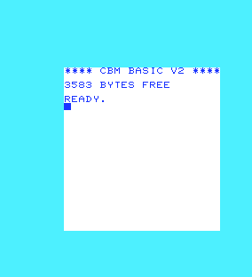
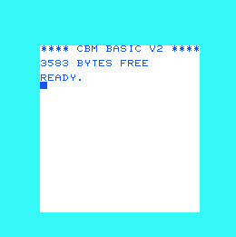

# VIC display reference and original VIC-20 firmware boot

## Display, bus, light-pen and sound reference

`scripts/fetch_ntsc_reference.py` verifies the pinned MAME revision
`41a494b6ef80adc924ccb2bdba1ee69580276e0c` (hashes in
[raster_reference.md](raster_reference.md)) and extracts nineteen complete,
byte-preserved functions plus the original `OUTPUT_DELAY` line into
`work/ntsc-reference/mame_display_functions.inc`: `device_reset`,
`raster_line`, `last_line_cycles`, `open_v`, `close_v`, `open_h`,
`handle_vmc`, `count_vmc`, `end_of_line`, `end_of_frame`, `fetch_byte`,
`fetch`, `output_pixels`, `trigger_light_pen`, `cycle`, `read`, `write`,
`lp_w` and `sound_stream_update`.

`tb/vic_display_oracle.cpp` supplies only services: class fields with
`device_start` initial values, a memory space that records each display
fetch, a bitmap that records the latest four colors, identity palette and
DAC tables (so color and DAC *indices* are compared), POT callbacks and an
inert `update_cycles`. Two instances run the NTSC and PAL constructors'
constants. Per clock the adapter applies the light-pen level, runs the
original `cycle()`, generates a sound sample on every second clock, and
applies CPU reads/writes in the order stated by each harness.

`tb/vic_test.cpp` compares both RTL profiles with this reference on every
clock: fetch strobe, matrix/character kind, 14-bit address, four pixel
colors, register reads and sound levels at sample points. Stimulus: the
KERNAL's standard PAL/NTSC screens, a tall-character screen, 160 random
register programs over refilled memory with color/sound/read traffic,
light-pen pulses, clock holds and resets, fully random bus traffic to all
registers and mirrors, a directed light-pen edge sweep across each
profile's frame boundary, and eight interlaced NTSC frames. Coverage
counters must be nonzero for both profiles. `scripts/run_vic_mutants.sh`
seeds twelve RTL defects (load pipeline, color timing, character mask,
start delay, matrix carry, column cap, light-pen extra bit and relock,
noise tap/edge, prescale, next-readback) and requires each to fail.

## Original firmware boot

`scripts/fetch_vic20_firmware.py` downloads Commodore's original ROMs into
ignored `work/vic20` and checks SHA-256 digests. Their SHA-1 values equal
the `ROM_LOAD` entries in MAME's
[vic20 driver](https://github.com/mamedev/mame/blob/41a494b6ef80adc924ccb2bdba1ee69580276e0c/src/mame/commodore/vic20.cpp)
at the same revision, an independent identification of each image:

| ROM | SHA-1 (= MAME `ROM_LOAD`) |
|---|---|
| BASIC 901486-01 | `587d1e90950675ab6b12d91248a3f0d640d02e8d` |
| KERNAL 901486-06 (NTSC) | `06de7ec017a5e78bd6746d89c2ecebb646efeb19` |
| KERNAL 901486-07 (PAL) | `ce0137ed69f003a299f43538fa9eee27898e621e` |
| Characters 901460-03 | `4fd85ab6647ee2ac7ba40f729323f2472d35b9b4` |

The archive's [KERNAL notes](https://www.zimmers.net/anonftp/pub/cbm/firmware/computers/vic20/kernal.differences)
state that 901486-06 is for NTSC-M systems with a 14318181/14 Hz clock and
a 6560, and 901486-07 for PAL-B with 17734472/16 Hz and a 6561. The PAL
rate agrees with MAME's 4.433619 MHz / 4 and not with the datasheet's
printed 4.436187 MHz oscillator; that discrepancy is narrowed, not closed
by a board measurement.

`tb/vic20_top.sv` connects the native 6502 (`design/mos_6502_family/mos_6502`), two 6522
VIAs (`design/mos_6522`) and `mos_6560`. Board decode follows MAME's
`vic20_mem`/`vic_videoram_map`: 1 KB RAM at $0000, 4 KB at $1000, character
ROM at $8000, VIC at $9000-$900F, VIA1 (A4, NMI) and VIA2 (A5, IRQ) in
$9000-$93FF, 4-bit color RAM at $9400, BASIC at $C000, KERNAL at $E000.
The VIC's view maps character ROM to $0000, color RAM to $1400 and RAM to
$2000/$3000. Keyboard, joystick, IEC, cassette and user port are idle; VIA1
PA5 drives the VIC light-pen input as on the board. Fixture assumptions:
unmapped CPU reads return the address high byte and undriven VIC fetches
read $FF (MAME returns its VIC bus latch for both).

`tb/vic20_boot_test.cpp` resets the system, requires the first executed
instruction to be the KERNAL reset entry with its opcode, compares the VIC
with the MAME reference on every clock and every VIC register read, and
runs until "READY." plus four more frames. It then checks the complete
22 x 23 screen at $1E00 (KERNAL screen page $1E at $0288):

```
**** CBM BASIC V2 ****

3583 BYTES FREE

READY.
<cursor>
```

Measured on 2026-10-23 (see the final report for the full suite):

| Profile | KERNAL | Clocks | Frames | VIC writes | Matrix fetches | IRQ entries | READY at clock |
|---|---|---:|---:|---:|---:|---:|---:|
| PAL 6561 | 901486-07 | 645,089 | 29 | 18 | 24,288 | 7 | 556,480 |
| NTSC 6560 | 901486-06 | 625,083 | 36 | 18 | 28,046 | 7 | 556,702 |

The last complete RTL frame (whole raster including blanking, MAME's
palette for visualization only):

 

## Limits

This boot exercises the KERNAL's VIC initialization, screen clearing,
text output, cursor blink and jiffy IRQs, not every display mode, sound,
light pen or POT path; those are covered by the reference comparison only.
The reference is one emulator; agreement does not establish silicon
timing. Keyboard input, further original programs (games, cartridges,
sound) and capture from real hardware remain open before VIC sign-off and
before the requested systems build on it.
