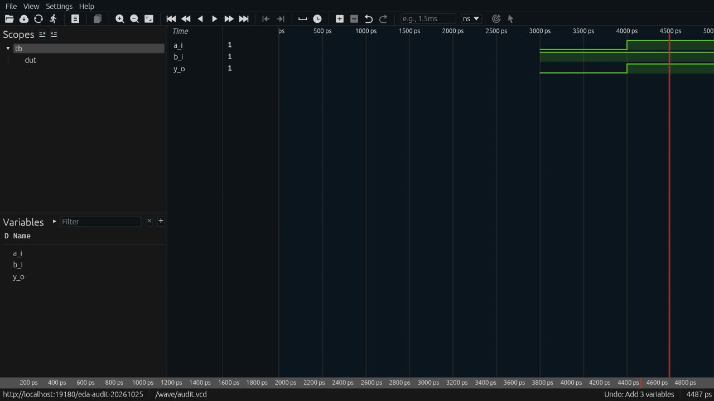

# EDA tool qualification — 2026-10-25

This report qualifies the selected workflows in the current pinned hardware-tool image, not every upstream feature, future upgrade, standalone GUI or HDL Workbench browser integration. The work is linked to the transferred owning-repository issues. Project status **AI verified** describes this inspected baseline evidence; issue closure still requires any remaining acceptance and source/PR review. No human-verification claim is made.

## Images and reproducibility

- Base `ai-hw-engineer:latest`: `sha256:93051caf5a9f2678a1653cf85af576f7a9ee6cc66dded18e53c4ccc91a58cad5`; pinned root recipe and Java/oracle results are in [the image report](family-layout-migration.md).
- Fixed overlay `ai-hw-engineer-apple-ii:latest`: `sha256:a18124d8a7e0e1063ec6e44bed4ccf597f6d9d7684cc203f7f9bca3f008ded2a`. It adds the pinned `iverilog=12.0-3` package and its narrowly targeted helper fix. The base image is not claimed to contain Icarus.
- The full base image build passed in the preceding Java work. This audit rebuilt the overlay, whose image-build smoke tests must all pass. No registry image was published.

```sh
docker run --rm -v "$PWD:/work" -w /work ai-hw-engineer:latest   python3 scripts/check_eda_tools.py

docker build -f system/apple_ii/Dockerfile -t ai-hw-engineer-apple-ii .
docker run --rm -v "$PWD:/work" -w /work ai-hw-engineer-apple-ii   python3 scripts/check_eda_tools.py --tools iverilog --work-dir scratchpad/eda-audit-icarus
```

The script writes actual commands, exit codes, log paths and pass/fail results to its ignored work directory's `results.json`. Expected failures must contain the expected diagnostic; an unrelated failure does not pass. A failed tool/probe exits the overall audit nonzero.

## Inspected baseline

| Tool / owning issue | Evidence | Result |
| --- | --- | --- |
| [Xezim #69](https://github.com/hevangel/ai_hw_engineer/issues/69) | Native simulation checks AND truth-table values; direct `$fatal` exits nonzero with its expected diagnostic; source-driven VCD requires explicit `--wave` and was loaded by Surfer | PASS |
| [UVM #74](https://github.com/hevangel/ai_hw_engineer/issues/74) | IEEE 1800.2-2017 with Xezim and `UVM_NO_DPI`: factory/test selection, phase objection lifecycle, zero-fatal success and deliberate fatal termination/report counts | PASS |
| [Verilator #73](https://github.com/hevangel/ai_hw_engineer/issues/73) | 5.052: actual generated binary tests the truth table; syntax error is rejected with a nonzero exit | PASS |
| [Yosys #75](https://github.com/hevangel/ai_hw_engineer/issues/75) | 0.69 at `9f75ca1f9`: synthesize and structurally check a real design, emit JSON; reject an unresolved cell | PASS |
| [EQY #70](https://github.com/hevangel/ai_hw_engineer/issues/70) | Image-pinned EQY/Yosys plugins prove RTL-to-synthesis equivalence; deliberately different AND/OR designs fail the equivalence proof | PASS |
| [SymbiYosys #76](https://github.com/hevangel/ai_hw_engineer/issues/76) | Z3 BMC, induction proof and reachable cover for a counter recurrence; false bound produces an actual counterexample | PASS |
| [Verible #72](https://github.com/hevangel/ai_hw_engineer/issues/72) | Version, real formatting/lint and deliberate syntax rejection | PASS |
| [Icarus #71](https://github.com/hevangel/ai_hw_engineer/issues/71) | Compile/run four-state Z/one checks; packaged C and C++ VPI helper builds and actual module loading; documented direct-cc build; `$fatal` returns nonzero | PASS after fix |
| [Surfer #68](https://github.com/hevangel/ai_hw_engineer/issues/68) | 0.7.0: actual built-in browser loads a simulated VCD through local Surver/proxy, expands `tb`, adds three signals, samples both states and zooms | PASS |

## Icarus defect and prevention

The pinned distro's helper contains `0-3` inside both `CFLAGS` and `CXXFLAGS`. A real VPI compilation failed with `cc: error: 0-3: linker input file not found`. This was already noted as a workaround in the board guide; version checks alone did not exercise the broken helper. The overlay now removes only that standalone token from those two assignments, preserving other flags, include paths, license and simulator/reference source. Both C and C++ helper build/load probes now pass during image build and in a separate fresh container. See [the defect note](../failure_notes/2026-10-25-icarus-vpi-helper.md).

## UVM exit semantics

An initial audit assumption that `uvm_fatal` must produce the same process exit as direct SV `$fatal` was incorrect. The installed UVM library reports `UVM_FATAL: 1` and terminates with `$finish`. Xezim documents `--error-exit` for `$error`, with direct `$fatal` always nonzero. The final probe checks UVM severity counts and verifies that code after the fatal report is not executed; the independent direct-SV fatal probe separately verifies nonzero process failure. A zero UVM process exit is never accepted as success without inspecting its report summary.

## Built-in browser proof

The local viewer ran on loopback port 19180. In the built-in browser it loaded `/wave/audit.vcd`, expanded `tb`, added `a_i`, `b_i`, `y_o`, placed a cursor at approximately 3494 ps (values `0,1,0`) and 4487 ps (`1,1,1`), and exercised zoom in/out. The screenshot below records the later sample. The earlier physical-key interruption did not verify this UI; this later built-in-browser run did.



## Limits and follow-up

This does not establish every simulator language feature, every UVM version/DPI mode, Verible LSP behavior, native Surfer desktop GUI behavior or arbitrary large-waveform performance. HDL Workbench's separate WASM Worker/adapter integration remains owned by its existing application tracker. Hardware functional/silicon verification is not inferred from these tool probes. The unrelated 8086 synthesis time bound and network-dependent firmware sign-off limits in the previous migration report remain unchanged.

Recorded CLI probe counts: xezim 3, uvm 2, verilator 4, yosys 3, eqy 2, sby 2, verible 4, iverilog 9; total 29. Surfer browser steps are recorded separately above.
