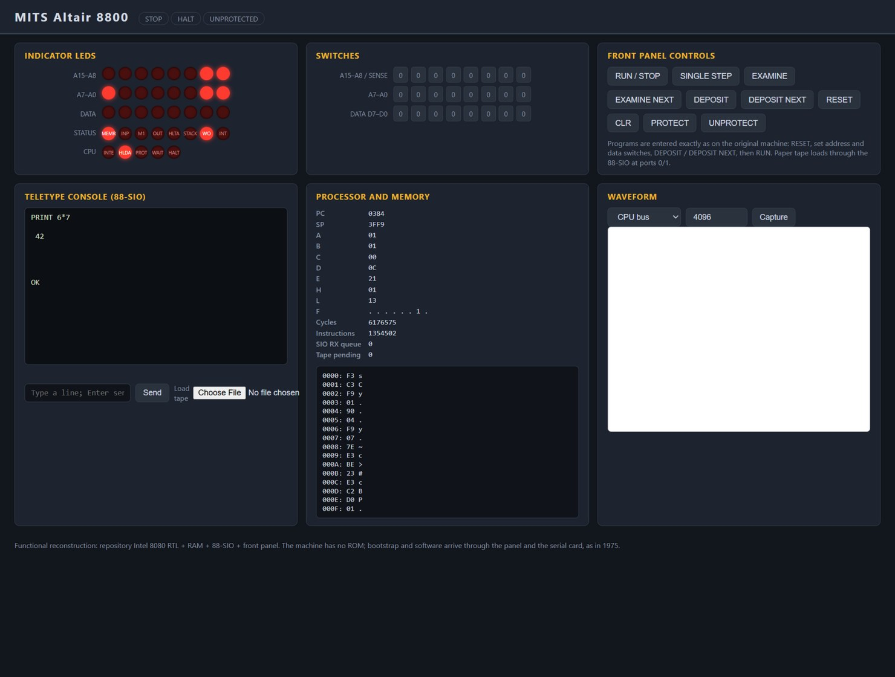

# MITS Altair 8800

**First introduced: 1975.** The Altair 8800 was announced on the cover of
[Popular Electronics, January 1975](https://www.americanradiohistory.com/hdgrpx/Popular-Electronics/70s/Popular-Electronics-1975-01.pdf)
and shipped the same year. It is the machine that made the Intel 8080 the
first mass-market microprocessor and started the personal-computer industry;
Micro-Soft's first product, Altair BASIC, was written for it.

This virtual platform wires the repository's verified Intel 8080 RTL into a
16 KiB static RAM board, a MITS 88-SIO serial card at ports 0/1, the
front-panel display/control logic and the S-100 status lamps. The machine has
no ROM: programs are toggled in through the front panel and loaded from
"paper tape" over the serial card, exactly as the original operated. The
original MITS front-panel bootstrap (20 bytes, octal listing in
[spec/reference/LDR4K32-octal.PRN](spec/reference/LDR4K32-octal.PRN)) loads
the original Altair 4K BASIC 3.2 tape, which is fetched at run time into the
ignored `work/` folder and hash-checked.

## Web interface and waveform



The RTL front panel after booting original 4K BASIC 3.2 through the panel and
the 88-SIO tape reader, with `PRINT 6*7` typed on the teletype and answered
`42` by BASIC. The status lamps (MEMR, WO) and HLDA show the last latched bus
cycle, the processor table shows the live PC/registers of BASIC's input loop,
and the memory window shows the interpreter's first bytes (`F3` DI, `C3` JMP).
This screenshot does not show a populated waveform viewer: the waveform panel
implements FST capture and an embedded Surfer viewer, but the image's bundled
Surfer 0.7.0 web app crashes at startup in the automation browser used for
capture, so no waves are shown in the image. The capture pipeline itself
(FST write, `/waveform.fst` endpoint, version header) is verified by
`scripts/test_backend.py`.

Reproduce: start the panel, press RESET, deposit the bootstrap through the
switches (or drive `/api/control`), load the 4K BASIC tape, RUN, answer
`MEMORY SIZE`/`TERMINAL WIDTH` with CR, `WANT SIN/RND/SQR` with N, then type
`PRINT 6*7` on the teletype.

## Run

From the repository root, using the project's tool image:

```sh
docker run --rm --name altair-panel -p 127.0.0.1:8800:8080 \
    -v "$PWD:/work" -w /work ai-hw-engineer:latest \
    sh system/altair_8800/scripts/run_system.sh
```

Open <http://localhost:8800/>. On Windows PowerShell, mount the repository
as `-v B:/ai_hw_engineer:/work` as in the ibm_pc instructions. The machine
is stopped with a blank RAM. To
boot like 1975: press **RESET**, set the address switches to 0000, toggle the
20 bootstrap bytes from
[spec/reference/LDR4K32-octal.PRN](spec/reference/LDR4K32-octal.PRN) into the
data switches and press **DEPOSIT** then **DEPOSIT NEXT** per byte, pick a
tape file (the panel downloads 4K BASIC 3.2 on start into `work/`), load it
with **Load tape**, press **RESET** then **RUN / STOP**, and answer the
startup prompts on the teletype: CR, CR, `N`, `N`, `N`. At `OK` type any
BASIC program. **SINGLE STEP**, **EXAMINE**/**EXAMINE NEXT**,
**DEPOSIT**/**DEPOSIT NEXT**, **PROTECT**/**UNPROTECT** and the 16+8 toggle
switches follow the [Operator's Manual](spec/spec.md) semantics; the upper
eight address switches are the sense switches (input port FFh).

Run the complete verification with:

```sh
docker run --rm -v "$PWD:/work" -w /work ai-hw-engineer:latest \
    sh system/altair_8800/scripts/run_all.sh
```

## Verification and boundaries

`scripts/run_all.sh` passes all five stages: strict lint, the board
testbench, the real-software regression, the backend API test and a Yosys
synthesis check. The real-software regression
([scripts/test_software.py](scripts/test_software.py)) toggles the original
bootstrap in through panel commands, runs the machine, feeds the original
4K BASIC 3.2 tape through the 88-SIO, answers the startup prompts and
requires byte-exact console responses: `PRINT 2+2` → `4`,
`PRINT 3/8` → `.375` (floating point), a `FOR/NEXT` loop → `1 2 3`, and
`PRINT "ALTAIR"` → `"ALTAIR"`. The board testbench runs the Operator's
Manual add program (12+34 = 46) through the actual DEPOSIT/DEPOSIT NEXT/RUN
path and checks EXAMINE, PROTECT, SINGLE STEP, the 88-SIO status-bit
contract, console echo and sense-switch input.

This is a functional virtual platform. Out of scope: S-100 electrical
timing, the 88-SIO's interrupt facility (an OUT to the control port is
accepted and ignored), DMA cards, cassette/floppy subsystems, the 8800b's
different panel electronics, and per-board memory protect granularity. The
RAM storage model is an explicit external interface and is treated as a
blackbox by the synthesis check, matching the ibm_pc system's convention.
Single step stops at the next instruction boundary plus the following M1
opcode fetch, the original panel's stop-at-next-M1 behavior and the only
boundary the 8080 core's HOLD contract supports.

- [Specification and assumption ledger](spec/spec.md)
- [Implementation plan](plans/implementation_plan.md)
- [Reference provenance](spec/reference/README.md)
- [Verification report and limits](report/final_report.md)
