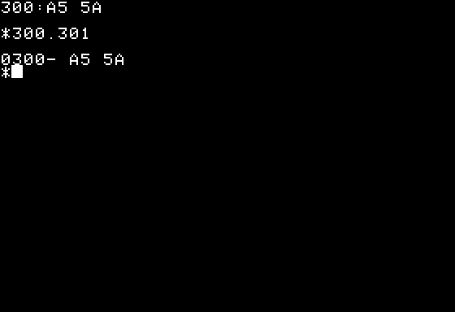

# Apple II revision-0 reconstruction

The Apple II first shipped in **1977**, as recorded by the
[Computer History Museum](https://www.computerhistory.org/tdih/june/10/).
This system reconstructs the revision-0 motherboard's IC package functions
and numbered pin connections. The
[Apple II Reference Manual](https://apple2history.org/dl/Apple_II_Redbook.pdf)
anchors the circuit and memory-selection wiring.

The reference system instantiates **83 IC packages**: 24 individual 4116s,
six ROM sockets, a 2513 character generator, TTL/bus-interface packages,
555 and NE558 timers, a 741 amplifier, and either the authored NMOS 6502
or an independent simulation-only transistor reference. All digital shared-memory
transactions pass through the wired buffers, address multiplexers, strobes,
and data latches.

The original Monitor boots, clears its screen through physical keyboard
input, and accepts `300:A5 5A`, then `300.301`. The regression checks the
deposited bytes, CPU-bus readback, printed text, and every visible serial
video pixel in a complete frame. Nine further full frames cover text
attributes/pages, lores, hires, mixed-mode boundaries, blanking, and sync.
The project's authored [6502 core](../../design/mos_6502_family/mos_6502/cycle) now runs the same
Monitor, display and cassette-byte regressions on this motherboard. The
transistor reference remains an independent comparison option.

## Run

```sh
# From repository root, after building the main tools image:
docker build -f system/apple_ii/Dockerfile -t ai-hw-engineer-apple-ii .
docker run --rm -v "$PWD:/work" -w /work/system/apple_ii \
    ai-hw-engineer-apple-ii sh scripts/run_all.sh
```

The optional CPU/ROM artifacts are fetched to ignored `work/` with pinned
revisions and SHA-256 checks. See [dependency ownership and licenses](board/DEPENDENCIES.md)
before using the external reference. The solver is MIT; its transistor
netlist is CC BY-NC-SA 3.0. The historical ROM is not relicensed by this project.

`run_all.sh` runs actual firmware, then deliberately reports incomplete
system sign-off: exact analog reconstruction and original-dump font comparison
remain outstanding. The authored CPU documented-instruction gate passes.
Individual regressions have separate passing scripts. The motherboard uses
Icarus; package tests use Xezim.
The retained Xezim board regression currently exposes a resolved-bus failure.

## Documents

- [System specification](spec/spec.md)
- [Chip inventory](spec/chip_inventory.md)
- [Analog boundary and assumptions](spec/analog.md)
- [Cassette byte-routine contract](spec/cassette.md)
- [Connectivity provenance and corrections](board/README.md)
- [Implementation plan](plans/implementation_plan.md)
- [Verification evidence and remaining work](report/final_report.md)
- [Supporting package library](../../design/apple_ii_chips/README.md)

## Digital video evidence

Run `sh scripts/run_video_sim.sh` for the nine diagnostic frames, or
`sh scripts/run_reference_boot.sh` for the historical Monitor display.
Both require Icarus and the pinned external font/firmware cache described above.
The generated `work/video_0.png` through `work/video_8.png` and
`work/monitor_video.png` contain observed B10 output samples. They are decoded
monochrome rasters, not an analog composite-voltage or color simulation.
The scripts also retain raw CSV captures and require exact pixel comparisons.

Revision 0 ignores the high bit of hires bytes; it has no later-board half-dot
delay. The [video specification](spec/spec.md#digital-video-acceptance-contract)
identifies the original schematic and circuit-analysis sources for that behavior.
The Monitor clear uses ESC then `$40` (`@`, physical Shift-P), rather than a
modern uppercase P keycode.

## Cassette evidence

Run `sh scripts/run_cassette_sim.sh` for the original F8 WRITE body and
RDBYTE routines, entered with `D000G` through the Monitor and keyboard pins.
Only the D0 socket holds the project-authored exerciser. Both input polarities
must produce the six test bytes and checksum, followed by actual DRAM readback.
Physical J13 output edges must match exact firmware cycle counts and byte
order. The cassette jack exposes R18/R19 divider voltage with explicit
configurable TTL-level and recorder-load assumptions. Raw edge and input
captures are retained in `work/`. The full WRITE/READ commands now pass nine cases in a compiled CPU/firmware
harness, including the unmodified leader, sync acquisition, page crossing,
checksum errors, input polarity and speed variation. Run
`sh scripts/run_cassette_command_firmware.sh`. That harness uses behavioral
memory/I/O for speed. Pre-charge full-command physical-board integration passed:
`run_full_write_board.sh` checks all 16,499 transitions and 16,498 intervals;
`run_full_read_board.sh` checks six received bytes/DRAM readbacks and correct
ERR behavior for both input polarities and good/bad checksums. These tests
use every original firmware byte and the complete original delays. The final
post-copper/charge long-command rerun was not recorded as passed; see the report.

## Front panel and output circuits

Run `sh scripts/run_host.sh` inside the tools container to serve the live
monochrome front panel. With Docker, publish only a local port:

```sh
docker run --rm -p 127.0.0.1:18080:8080 -v "$PWD:/work" \
    -w /work/system/apple_ii ai-hw-engineer-apple-ii \
    sh scripts/run_host.sh --bind 0.0.0.0
```

Open `http://127.0.0.1:18080`. Keyboard input, Reset, Integer BASIC and screen
clear operate the actual board pins. Video comes from observed B10 serial
output, with unknown pixels preserved. The simulator runs slower than real
hardware; queued commands take simulated time to execute. See [host contract](spec/host.md).
`run_host_test.sh` checks transport ordering, appended input and frame encoding.

Run `sh scripts/run_output_sim.sh` for Q3's loaded composite-video network and
Q4's AC-coupled speaker driver. It checks the actual LC tank/component nets,
independent impedance response, DC levels, speaker current/energy decay and
integration convergence. Both CPU wrappers connect these models with
`ENABLE_ANALOG_OUTPUTS=1`; observable real voltages have separate validity flags.
The front panel currently shows monochrome digital pixels, not decoded analog
color or acoustic output. See [device assumptions](spec/analog.md).

The original Integer BASIC physical regression is `run_basic_sim.sh`:
keyboard-entered FOR/NEXT arithmetic, POKE/PRINT, GR/PLOT/SCRN, speaker PEEK,
and Monitor readback. Its script is part of the complete acceptance suite.
[Completion work](spec/completion.md) lists the remaining requirements.

## Authored CPU option

Run `sh scripts/run_authored_boot.sh` and `sh scripts/run_authored_cassette.sh`
to execute firmware using `apple_ii_rev0_authored` and its 40-pin H7 adapter.
The same motherboard, physical RAM path, analog support and test stimuli are
used. These runs do not load the external CPU VPI module. `run_all.sh` includes
both authored and reference firmware options; whole-system analog sign-off
remains incomplete as described in the report.

## Copper and floating bus verification

`python3 scripts/check_copper_ic_wiring.py` compares every IC pad against a
separate reconstruction traced from real revision-0 copper: 83 packages and
1,368 pads, including eight unconnected pads omitted by imported symbols.
It rejects both split nets and shorted nets regardless of source net labels.
The provenance and two newly corrected differences are in [board ledger](board/README.md).
This covers IC net membership; non-IC components still require the bounded
schematic checks and additional analog validation.

`sh scripts/run_floating_bus_sim.sh` checks retained video data on actual
system data nets. It covers undriven I/O, D7-only cassette/button/paddle reads,
strong slot drives, contention, warm reset and recovery. Its negative control
must fail when the charge model is disabled. The generator exposes the real
slot data nets through `system_data_bus`, so external devices can drive the
same resolved bus. Charge/leakage assumptions are explicit in [analog.md](spec/analog.md).

## Web interface and waveform



This retained front-panel capture shows the original Monitor accepting
`300:A5 5A` and examining `300.301`. It was captured during the original
branch validation, before this integration. The panel displays observed
serial video pixels from the physical motherboard. It has no browser waveform
viewer yet; raw signal captures remain in ignored `work/`. Analog color and
audio presentation remain outside the current interface.

## Integration status

The functional motherboard, firmware regressions and front panel are included.
The [physical-bus CPU](../../design/mos_6502_family/mos_6502/cycle) preserves the original
branch's dummy-cycle and pin-timing behavior. The separately completed
[functional-bus CPU](../../design/mos_6502_family/mos_6502) remains available with its own
Klaus and formal verification. Both implementations and their tests are kept;
no verification result is transferred between them.

Exact analog fidelity and original character-ROM provenance remain open.
The full suite deliberately returns status 1 after all functional tests pass
until those sign-off requirements are met. See the
[verification report](report/final_report.md).
