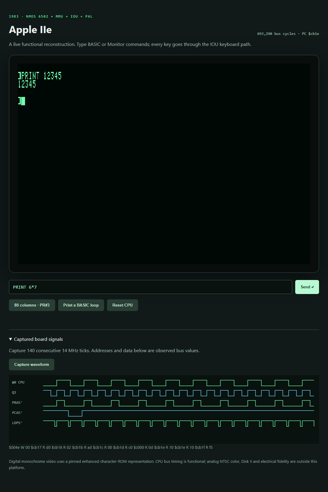

# Apple IIe functional virtual platform

The Apple IIe launched in **January 1983**. This build joins the project's
NMOS 6502, MMU 341-0266, IOU 341-0267 and timing PAL with 64 KiB main plus
64 KiB auxiliary RAM. Introduction dating follows the existing chip
[history notes](../../design/README.md#apple--iie-mmu-and-iou), including the
[Centre for Computing History](https://www.computinghistory.org.uk/det/209/Apple-IIe).

The unchanged original Apple2e ROM boots to **Apple ][** and Applesoft BASIC.
Real keyboard events execute POKE 768,55, PRINT 6*7 and PR#3. The latter enters
the original 80-column firmware and writes both main and auxiliary text RAM.
The platform is a functional bus reconstruction; it does not claim exact
NMOS bus timing, analog NTSC color, Disk II, tape electronics or PAL fuse-level
video equivalence. The 14 MHz PAL and the cycle-level CPU/IOU are composed
using the explicit [timing and reset contract](spec/spec.md).

## Run

From the repository root, using the existing tools image:

```sh
docker run --rm -v "$PWD:/work" -w /work ai-hw-engineer:latest sh system/apple_iie/scripts/run_all.sh
# Actual ROM gate on the independent SystemVerilog simulator:
docker run --rm -v "$PWD:/work" -w /work ai-hw-engineer:latest sh system/apple_iie/scripts/run_xezim_firmware.sh
# Fast interactive panel (local port only):
docker run --rm -p 127.0.0.1:18083:8080 -v "$PWD:/work" -w /work ai-hw-engineer:latest sh system/apple_iie/scripts/run_host.sh --bind 0.0.0.0
# Optional xezim/DPI backend for the same panel:
SIMULATOR=xezim sh system/apple_iie/scripts/run_host.sh
```

Open http://127.0.0.1:18083 for the Docker panel. Commands and Reset control
the RTL; images contain IOU scanner samples, not a software CPU rendering.
Capture waveform records 140 consecutive master ticks and observed bus data.
Both backends use a single simulation driver. Simulation advances as fast as
the host permits, without claiming wall-clock hardware speed.

## Web interface and waveform



Actual local browser capture from the Verilator backend after keyboard-driven
PRINT 6*7, PR#3 and PRINT 12345; waveforms are observed master-clock samples.
The panel includes keyboard input, 40/80-column sampled video and a board
waveform viewer. Rendering uses hash-pinned enhanced-IIe character-ROM data
with IOU character-address pins; it does not certify original 1983 mask-font
identity. The system ROM remains the original NMOS image, not the 65C02 image.

## Documentation

- [System specification and assumption ledger](spec/spec.md)
- [Implementation plan](plans/implementation_plan.md)
- [Verification report](report/final_report.md)
- [External artifacts and licenses](spec/dependencies.md)
- [Firmware-discovered MMU/IOU defects](../../failure_notes/2026-10-19-apple-iie-rom-switches.md)
