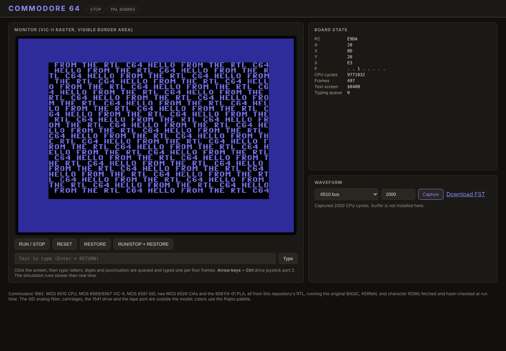

# Commodore 64

The Commodore 64 combines a MOS 6510 CPU, a 6569 (PAL) or 6567 (NTSC)
VIC-II video chip that also arbitrates the bus and refreshes DRAM, a 6581
SID sound chip, two 6526 CIAs (keyboard and joysticks; serial bus, VIC bank
and NMI), 64 KiB of DRAM, 1 Kx4 color RAM and the 906114-01 PLA that banks
RAM under the BASIC, KERNAL and character ROMs. This virtual platform wires
the repository's own RTL for every one of those chips onto one board clocked
by the VIC dot clock, and boots the original, unmodified BASIC V2 and KERNAL
901227-03 to `READY.`. On the PAL board the boot matches VICE x64sc cycle
for cycle: the first six KERNAL IRQ entries, the first READY-loop fetch,
the complete 64 KiB RAM image there and two 8,192-instruction cycle-stamped
traces are identical.

**First introduced: 1982.** MAME's
[c64.cpp at a pinned commit](https://github.com/mamedev/mame/blob/41a494b6ef80adc924ccb2bdba1ee69580276e0c/src/mame/commodore/c64.cpp)
dates both the NTSC and the PAL Commodore 64 to 1982. Only the year is
claimed here; the announcement and first-shipment months are not asserted.
Its bus-sharing VIC-II and three-voice SID made it a major home-computer
platform for games and music through the 1980s.

## Web interface and waveform



The RTL board after booting the original ROMs, then typing
`POKE 53280,6:POKE 53281,0`, `10 PRINT "HELLO FROM THE RTL C64 ";`,
`20 GOTO 10` and `RUN` through the panel's typing queue; the machine was
stopped about 500 frames after power-on and a 2,000-CPU-cycle waveform was
captured. **The Surfer waveform viewer is not shown:** the build container
used for this screenshot cannot download Surfer (it is built from GitLab in
the repository image, and that host is blocked here), so the panel hides its
viewer and offers the FST download instead. The capture endpoint itself is
verified by `scripts/test_backend.py`. In the repository image the same
**Capture** button loads the FST into the embedded Surfer viewer with three
signal presets (6510 bus; VIC-II DMA and interrupts; PLA, IEC and SID).

Reproduce: start the panel, press **RUN / STOP** and wait for `READY.`, type
the lines above into the text box (or click the screen and type), press
**RUN / STOP** to freeze, then **Capture**.

## Run

From the repository root, using the project's tool image:

```sh
docker run --rm --name c64 -p 127.0.0.1:8820:8080 \
    -v "$PWD:/work" -w /work ai-hw-engineer:latest \
    sh system/commodore_64/scripts/run_system.sh
```

Open <http://localhost:8820/> (Windows PowerShell: mount
`-v B:/ai_hw_engineer:/work`). `C64_VARIANT=1` selects the NTSC 6567R8
board. `run_system.sh` first fetches the BASIC 901226-01, KERNAL 901227-03
and character 901225-01 ROMs into the ignored `work/` folder and checks
their SHA-256 and MAME SHA-1 hashes. The machine powers up stopped; press
**RUN / STOP**. Printable keys are queued and typed by the server (the
simulation is slower than real time, so a browser key press is shorter than
one KERNAL keyboard scan); the arrow keys and Ctrl drive joystick port 2;
**RESTORE** and **RUN/STOP + RESTORE** pulse the NMI key.

Run the complete verification with:

```sh
docker run --rm -v "$PWD:/work" -w /work ai-hw-engineer:latest \
    sh system/commodore_64/scripts/run_all.sh
```

## Verification and boundaries

`scripts/run_all.sh` runs, on both boards where it applies:

1. ROM fetch and hash check; Verilator `-Wall` lint of the board and every
   chip (PAL and NTSC).
2. Independent oracle (`scripts/test_oracle.py`): unchanged VICE x64sc
   3.7.1 headless, same ROMs, zero-filled RAM. PAL is cycle-exact (see
   above). NTSC matches functionally (READY-loop registers and RAM image);
   badline stalls differ from VICE by one cycle in some cases, an open
   discrepancy recorded in the report.
3. Original-ROM regression (`scripts/test_software.py`): banner and
   38,911 bytes free; typed direct-mode and stored BASIC programs; the
   320x200 text window pixel-exact against an independent renderer built
   from screen RAM, color RAM and the character ROM; a SID voice whose
   measured pitch matches its frequency register; joystick port 2 through
   CIA1; CIA1 time of day counting from the mains input; RUN/STOP + RESTORE
   warm start through NMI.
4. Backend HTTP API test (typing, warm start, validation, waveform).
5. Yosys synthesis of the board and all chips with the storage model
   blackboxed (193,614 cells, 0 problems).

Out of scope: the SID's analog filter and DAC (audio is a digital voice
mix), sampled combined-waveform tables, cartridges (the PLA's cartridge
modes are verified on their own), the 1541 drive and other IEC devices,
the datasette, paddles, light pen, and the composite video stage (colors
use the Pepto palette). The CPU/VIC power-on phase and DRAM power-on
contents are chosen, not measured; see the ledger.

- [Specification and assumption ledger](spec/spec.md)
- [Reference provenance](spec/reference/README.md)
- [Implementation plan](plans/implementation_plan.md)
- [Test plan](plans/testplan.md)
- [Verification report and limits](report/final_report.md)
