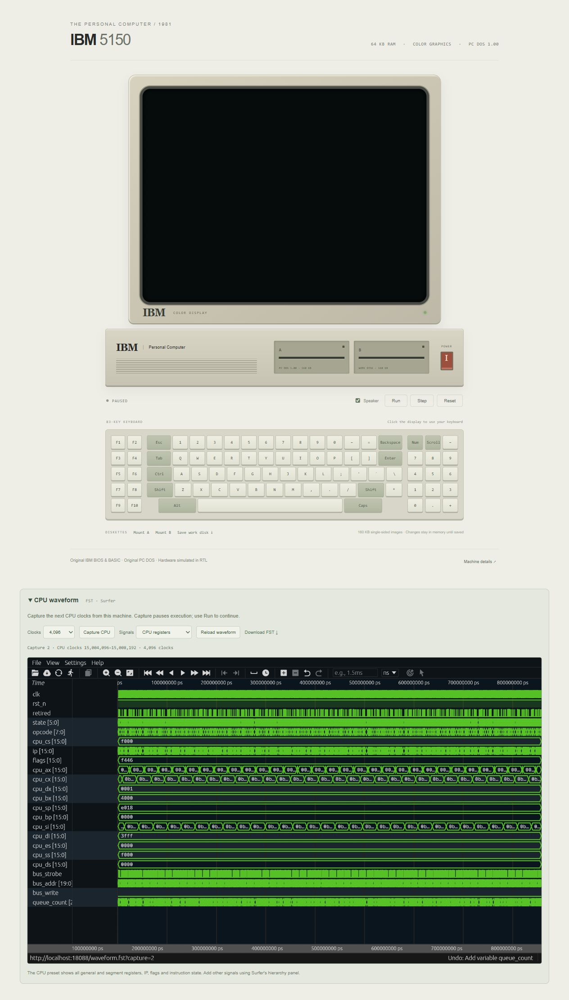

# IBM Personal Computer 5150

**First introduced: 1981.** IBM's [manufacturer history](https://www.ibm.com/history/personal-computer)
dates the original PC to August 1981. Its published architecture and BIOS
helped establish the PC software and expansion-card ecosystem.

This virtual platform runs the original IBM BIOS, Cassette BASIC and PC DOS
1.00 on the repository's RTL processor and peripheral chips. It implements
a 64 KiB, CGA-equipped 5150 with two single-sided 160 KiB drives and an
83-key keyboard interface. The CPU shares the verified 8086 execution unit;
its system adapter supplies the original PC's 8-bit bus and four-byte queue.
BIOS, DOS and application instructions and interrupts execute in RTL.

## Web interface and waveform



The RTL platform during BIOS POST with a 4,096-clock CPU capture loaded in the
embedded Surfer viewer. The CGA display is still blank at this stage of POST.
Power on, choose **4,096** clocks and press **Capture CPU** to capture the
current execution. Capture pauses the machine.

The front panel shows actual CGA memory with the original character ROM,
physical and on-screen scan-code keyboard input, run/pause/instruction step,
reset/power, speaker pitch derived from the PIT output, disk-image mounting
and a writable work disk that can be downloaded. RAM/ROM storage and decoded
floppy media are external simulation models, not CPU/BIOS emulation.

The **CPU waveform** panel embeds the same self-hosted Surfer viewer used by
BUSICOM. Power on, choose a clock window and press **Capture CPU**. It records
the next 256 clocks by default (up to 65,536), pauses the actual machine and
loads the finalized FST. Use **Run** to continue. **CPU registers** shows named
general/segment registers, IP, flags, instruction state and bus activity;
**CPU bus and DMA** shows byte-bus phases, prefetch and DMA ownership. Surfer
supports zooming, cursors and adding signals; **Reload waveform** restores the
selected preset, and **Download FST** saves the capture.

The viewer is served from `/surfer/` on the PC's own port using the Docker
image's bundled assets. It needs no separate port or hosted service. Capture
timestamps use the nominal 4.772727 MHz clock; they do not imply native 8088
instruction timing. Recording is bounded and only runs on request. Restarting
the simulator clears its capture session; Reset retains the last capture.

- [Specification and assumptions](spec/spec.md)
- [Implementation plan](plans/implementation_plan.md)
- [Reference provenance and hashes](spec/reference/README.md)
- [Verification results and limits](report/final_report.md)
- [BIOS-discovered controller defect](../../failure_notes/2026-10-14-intel8272-ibmpc-ready-events.md)
- [DMA programming defect](../../failure_notes/2026-10-14-intel8237-pending-grant-programming.md)
- [Format/VERIFY controller defects](../../failure_notes/2026-10-14-intel8272-format-terminal-count.md)

Run from the repository root inside `ai-hw-engineer:latest`:

```sh
sh system/ibm_pc/scripts/run_system.sh
```

On Windows, expose the local panel using the existing Docker image:

```powershell
docker run --rm --name ibm-pc-panel -p 127.0.0.1:8088:8088 -v B:/ai_hw_engineer:/work -w /work ai-hw-engineer:latest sh system/ibm_pc/scripts/run_system.sh
```

Open [the front panel](http://localhost:8088), power on, and allow the original
POST and disk boot to finish. At DOS's date prompt enter `10-14-81`, then try
`DIR`, `CHKDSK`, `BASIC`, or `BASICA DONKEY`. The first boot includes the full
RAM test. `PRINT 6*7` works inside BASIC; `SYSTEM` returns to DOS. DONKEY uses
the space bar. The machine has 64 KiB, so larger software may not fit.

Drive A starts with the unchanged PC DOS disk and is write protected. Drive B
is a new formatted FAT12 data disk. Mounted images must be exactly 163,840
bytes. Mounting pauses the machine; use Reset to boot the new disk or Run to
continue. Disk changes remain in the process until exported; reboot preserves
mounted media, while stopping the server discards unsaved changes. Downloaded
original firmware/media and build artifacts stay in ignored `work/`.

`scripts/run_all.sh` runs reproducible verification. This is a functional
virtual platform: original EU cycle counts, analog/composite video, raw flux,
external cassette recordings, physical keyboard electronics, serial/printer/
game adapters and electrical timing closure are outside the model. The speaker
viewer follows measured square-wave pitch, rather than exporting every audio
transition. Standard CGA modes are supported; arbitrary custom CRTC raster
timing and raster tricks are not claimed.
