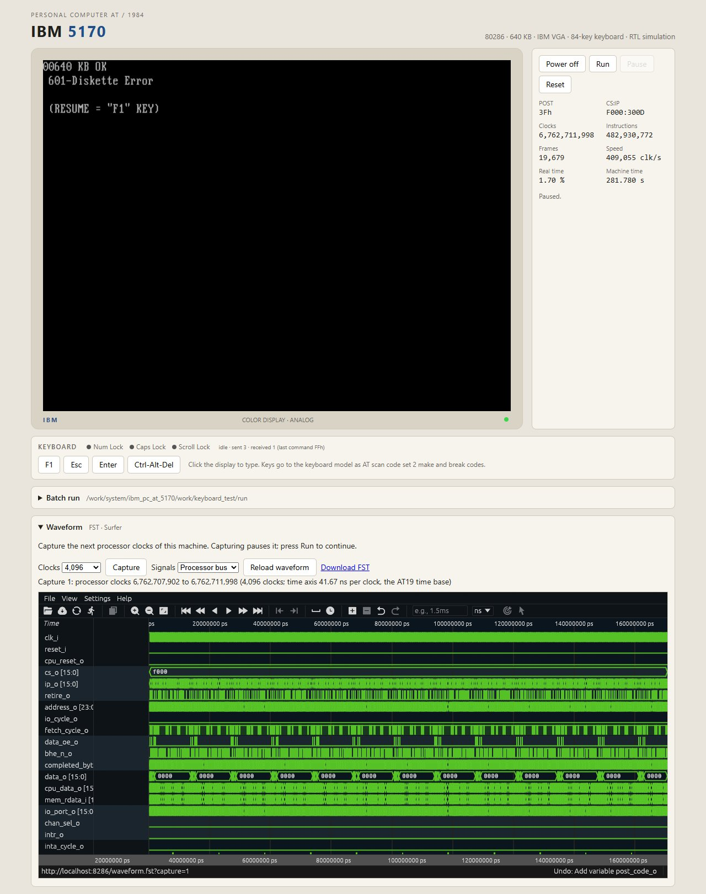
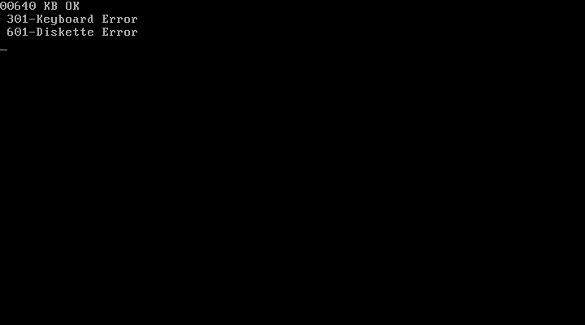

# IBM PC AT 5170

Milestone M4b part 1: the board has the 80286, timer, DMA and page registers,
refresh logic, the 8042 keyboard controller running IBM's own firmware, the
MC146818 clock, two 8259A interrupt controllers, the math-coprocessor ports
and the shutdown-to-reset path. A second machine top adds an I/O channel and
an IBM Enhanced Graphics Adapter (EGA) in an expansion slot. The unchanged
IBM BIOS and the card's own BIOS run about 18.0 million instructions of the
power-on self-test: both interrupt controllers are set up, memory is tested
in protected mode, the processor is reset through the 8042 three times, and
seven timer interrupts are taken. The EGA BIOS's own self-test passes and
its display shows `00640 KB OK` and ` 301-Keyboard Error`; the error is
correct, because no keyboard is plugged in (before the diskette adapter
was fitted it also showed ` 601-Diskette Error`). The run stops at POST
checkpoint 3Ch on the BIOS's first read of port 1F7h, the fixed-disk status
register. The board alone, without a card, stops at the same read.

Since the diskette milestone both display machines also have the IBM Fixed
Disk and Diskette Drive Adapter's diskette function in a slot and the
board's DMA controllers move data: the 601 error is gone, and the VGA
machine boots a script-built 1.2 MB test diskette whose boot program reads
the whole diskette, writes a sector and prints PASS (see "Diskette and
DMA"). No operating system has been booted yet.

A third machine top puts the IBM PS/2 Display Adapter (VGA) in the slot
instead of the EGA. The same BIOS and the card's BIOS run 16,610,979
instructions to the same stop, and the 720 x 400 display shows the same
two lines. The VGA BIOS sets its 80-column text mode (inferred from the
screen); graphics modes and the DAC are not exercised by this run.

The IBM Personal Computer AT (model 5170) was IBM's first 80286 machine. It
added a 16-bit expansion bus, 24-bit addressing (16 MB), a second interrupt
controller and DMA controller, an 8042 keyboard controller and a
battery-backed MC146818 clock with CMOS setup memory. These became the
"AT-compatible" base that later PCs followed. IBM's
[personal computer history](https://www.ibm.com/history/personal-computer)
dates it to August 1984; the exact day is not yet confirmed from an IBM
source. IBM's announcement letter for the EGA is dated 10 September 1984; see the
[EGA design](../../design/ibm_ega/) for sources.

This system runs the unchanged IBM AT REV1 BIOS (1984-01-10) on the
repository's [`intel_80286`](../../design/intel_80286/) RTL. The goal is to
boot PC DOS and then Microsoft OS/2 1.0.

Important chips: Intel 80286, 8254 timer, two 8259A interrupt controllers,
two 8237A DMA controllers, 74LS612 page registers,
8042 keyboard controller with IBM firmware 1503033, Motorola MC146818 clock
and the IBM EGA (five custom LSI devices, 256 KB display memory, IBM ROM
6277356) in the EGA machine, or the IBM PS/2 Display Adapter (VGA; 256 KB,
DAC, 24 KB adapter BIOS) in the VGA machine; in both machines the IBM
Fixed Disk and Diskette Drive Adapter's diskette function with an Intel
8272 (NEC 765-compatible) controller.

## Web interface and waveform



A real browser capture (headless Chrome 1280 x 1720 on the Docker host,
cropped, then converted to JPEG) of the page served by
`scripts/run_web.sh` on 2026-11-16. The machine, keyboard model attached,
had run 6,762,711,998 processor clocks (482.9 million instructions, 281.8
s of machine time at about 410,000 clocks per second) and waits at the
BIOS's prompt after POST checkpoint 3Fh: the monitor shows `00640 KB OK`,
` 601-Diskette Error` and ` (RESUME = "F1" KEY)` (the cursor is in its
blink-off phase). No 301-Keyboard Error. The Surfer view is the
**Processor bus** preset of capture 1, 4,096 processor clocks from clock
6,762,707,902 in the BIOS's F1 wait loop at `F000:3xxx`; capturing paused
the machine. To reproduce: start the page, **Power on**, wait for the
prompt (about 210 million clocks, 8 minutes, with the machine alone on
the host), choose 4,096 clocks and press **Capture**. On that pre-diskette
revision, pressing F1 resumed POST and stopped at checkpoint 40h on the
unmodeled 80287 probe; after merging the diskette adapter and empty
80287 socket (`AT36`), POST passes checkpoint 40h cleanly (and with a boot
diskette in drive A via `--fda=IMG`, boots without an F1 prompt; use
`--fda-type=none` to reproduce the 601/F1 prompt).

The page (`host/web/`, served by `host/server.py`) drives the VGA machine
through a persistent Verilator simulator (`host/simulator.cpp`):

- **Monitor.** The picture is rebuilt from the card's analog monitor
  connector (DAC codes scaled to 8 bits per gun, active area only) and
  shown at a 4:3 aspect ratio; it refreshes whenever a new frame has been
  completed.
- **Controls and status.** Power (a fresh model: power-on reset, RAM
  cleared, keyboard power-on), Reset (the same), Run and Pause. Status
  shows the POST checkpoint (port 80h), CS:IP, processor clocks,
  instructions, frames, the measured speed in processor clocks per second
  and as a fraction of real time on the AT19 time base (the processor
  clock stands for 24 MHz), and the machine time. A stop of the kind
  that ends the regression (for example an unclaimed I/O read below 100h)
  is shown and stops the machine.
- **Keyboard.** Click the display and type: browser key events are mapped
  to the 84-key AT keyboard's scan code set 2 (the table and its choices
  are at the top of `host/web/app.js`; cursor and editing keys use the
  numeric-keypad keys that carry them on the AT keyboard, F11/F12 have no
  AT key) and enter the keyboard model as key down and key up; browser
  auto-repeat is ignored because the model repeats on its own. Losing
  focus releases the held keys. Buttons send F1, Esc, Enter and
  Ctrl-Alt-Del. The Num, Caps and Scroll Lock lamps show what the BIOS set
  with command EDh.
- **Waveform.** Capture records the next 1,024 to 262,144 processor clocks
  to FST and opens it in the self-hosted Surfer (`/surfer/`, from the
  image). Presets: processor bus (clock, reset, CS, IP, retirement,
  address, cycle type, data both ways, I/O port, channel select, INTR and
  INTA, refresh, POST code), keyboard lines (both drivers and line levels,
  8042 port 2, OBF, port 60h reads) and video (video clock, pixel enable,
  syncs, display enable, DAC codes). Every signal of
  `host/ibm_pc_at_5170_vga_host.sv` is in the file. The time axis uses
  41.67 ns per processor clock (AT19). Capturing pauses the machine.
- **Batch run.** With `--batch-dir`, the page shows a batch run's live
  status and latest frame and steps or plays through its saved frames.

The POST regressions also save single frames, which are not the panel. The
image below is the last video frame of the EGA machine at the stop point (POST checkpoint 3Ch), captured in simulation
from the card's monitor connector (active area only, 640 x 350) and
written by `scripts/run_post_ega.sh` as `work/post_ega/frame.png`:


Reproduce it with `sh system/ibm_pc_at_5170/scripts/run_post_ega.sh "$ROM"`
(see Run). The three rows of text are checked by the script against the
ROM's own font; the frame is one picture, not a recording.

The next image is the same kind of frame from the VGA machine at the same
stop, captured from the card's analog monitor connector (the DAC's 6-bit
codes scaled to 8 bits per gun; 720 x 400) and written by
`scripts/run_post_vga.sh` as `work/post_vga/frame.png`:



Reproduce it with `sh system/ibm_pc_at_5170/scripts/run_post_vga.sh "$ROM"`
(see Run). The three rows of text are checked by the script against the
VGA ROM's own font; again one picture, not a recording.

## Run

### Web front end

From the repository root on the Docker host (the Docker image
`ai-hw-engineer:latest`; publish the port):

```sh
docker run --rm -it -p 8286:8286 -v "$PWD":/work -w /work ai-hw-engineer:latest \
    sh system/ibm_pc_at_5170/scripts/run_web.sh system/ibm_pc_at_5170/work/software/atbios.bin 8286
```

then open http://localhost:8286/. `run_web.sh BIOS [PORT] [--ext-kb N]
[--fda PATH] [--fdb PATH] [--fda-type 1.2|360|none] [--fdb-type 1.2|360|none]
[--fda-ro] [--fdb-ro] [--write-back] [--batch-dir DIR] [--script FILE]`
checks the BIOS's SHA-256, rebuilds and
hash-checks the 8042 firmware, fetches and hash-checks the VGA ROM (as
`run_post_card.sh` does), builds the simulator with `scripts/build_host.sh`
(about 1.5 minutes) and starts the server. The page starts with the
machine off; **Power on** starts it running. The BIOS image is obtained with
`scripts/get_bios.sh` (see below) and never committed.

The simulation is slow: about 430,000-450,000 processor clocks per
second, 1.8 % of real time on the AT19 time base. The memory count starts
after about 1 minute; with `--fda-type=none`, the diskette error and F1
prompt appear around 177-210 million clocks (about 7-8 minutes), while
booting the 1.2 MB test diskette with `--fda=IMG` reaches halt at about
423 million clocks (about 16 minutes). (Without a keyboard the exploratory
EGA run needed about 3 billion clocks to reach the prompt.)

### Batch runs and scripted keys

```sh
sh system/ibm_pc_at_5170/scripts/run_batch.sh BIOS CLOCKS OUT_DIR \
    [--ext-kb=N] [--fda=IMG] [--fdb=IMG] [--fda-type=T] [--fdb-type=T] \
    [--fda-ro] [--fdb-ro] [--write-back] [--script=FILE] [--save-every=N] [--until-script]
```

runs CLOCKS processor clocks with no browser. Every `--save-every` clocks
(default 50,000,000) it writes `OUT_DIR/status.json`, `latest.png` and
`screen.txt` (the screen read with the VGA ROM's font), adds the frame to
`OUT_DIR/frames/` when it changed (listed in `frames.json`), and at the end
writes `frame.ppm` for `scripts/check_frame.py`. Watch it, or replay it
later, with `run_web.sh BIOS 8286 --batch-dir OUT_DIR`.

A key script has one rule per line; the rules fire in order, each armed
when the previous one has fired, and the batch saves a frame when a rule
fires:

```
# comment
at 3000000000 F1                # at processor clock N
when "RESUME" F1                # when the screen text contains TEXT
wait 50000000 "dir\n"           # N clocks after the previous rule
when "A>" Ctrl+Alt+Del
```

Keys: names (`F1`-`F10`, `Esc`, `Enter`, `Tab`, `Space`, `Backspace`,
`Ctrl`, `Alt`, `Shift`, `RShift`, `CapsLock`, `NumLock`, `ScrollLock`,
`SysRq`, `KP0`-`KP9`, `KP.`, `KP+`, `KP-`, `KP*`, `Home`, `End`, `Up`,
`Down`, `Left`, `Right`, `PgUp`, `PgDn`, `Ins`, `Del`), a two-digit hex
set 2 code, `A+B+C` held together, or `"text"` typed with Shift as needed
(`\n` is Enter). Key events are applied 30 ms apart (AT23).

`--ext-kb=1408` gives a 2 MB machine (640 KB plus 1,408 KB from 1 MB).

### POST regressions

From the repository root, inside the `ai-hw-engineer` tool image:

```sh
ROM=$(sh system/ibm_pc_at_5170/scripts/get_bios.sh)
sh system/ibm_pc_at_5170/scripts/run_all.sh "$ROM"
sh system/ibm_pc_at_5170/scripts/run_post_ega.sh "$ROM"
sh system/ibm_pc_at_5170/scripts/run_post_vga.sh "$ROM"
```

`get_bios.sh` downloads the BIOS from the pinned PCjs archive into the
ignored `work/` folder and checks its SHA-256. The 8042 firmware (IBM part
1503033) is rebuilt and hash-checked by the 8042 design's script, also into
`work/`. `run_all.sh` lints the board, runs the BIOS in two clock
scenarios, checks the stop point in `scripts/expected_stop.txt`, compares
every 80286 instruction with Unicorn, checks the 8042 and the MC146818
against their reference models, and synthesizes the board, the EGA
machine and the VGA machine with Yosys. The two scenarios take about 20 minutes of simulation
and their Unicorn replays about 20 minutes each; `run_post.sh` takes about
54 minutes and synthesis about 12 more.

`run_post_ega.sh` needs only the path of the AT BIOS. It fetches the EGA
ROM (IBM 6277356) with `design/ibm_ega/scripts/get_rom.py`, which checks its
hashes and writes it to the ignored `work/` folder. It runs the EGA machine
in one scenario, checks the stop point in `scripts/expected_stop_ega.txt`,
checks the screen text in `tb/expected_screen_ega.txt`, replays the 8042
and the MC146818 into their models and compares every 80286 instruction
with Unicorn. It takes about 15 minutes of simulation and checks plus about
20 minutes for the Unicorn replay, and writes `work/post_ega/frame.png`.
`run_all.sh` does not run it.

`scripts/run_post_card.sh ega|vga /path/to/atbios.bin` is the one regression
for either card; `run_post_ega.sh` and `run_post_vga.sh` are wrappers.
`run_post_vga.sh` fetches the VGA ROM with `design/ibm_vga/scripts/get_rom.py`
(hash-checked, into the ignored `work/` folder), runs the VGA machine in one
scenario, makes the same five checks (stop point in
`scripts/expected_stop_vga.txt`, screen text in `tb/expected_screen_vga.txt`,
8042, MC146818, Unicorn) and writes `work/post_vga/frame.png`. `run_all.sh`
does not run it either. `run_synth.sh` also synthesizes the VGA machine.

## Diskette and DMA

Both display machines have the diskette function of the IBM Fixed Disk
and Diskette Drive Adapter in a slot (`src/at_diskette_adapter.sv`, with
the repository's `intel_8272`), and the board's two 8237s now move data
(DMA channel 2, page registers, arbitration with refresh, T/C). Drive A is
a 1.2 MB drive; images are raw sector files (`--fda=IMG`, `--fdb=IMG`,
`--fda-type=1.2|360`, `--fda-ro`, `--write-back`): 1.2 MB, 360 KB and
320 KB, and the 5150's single-sided 160 KB and 180 KB (AT38). Drive B
(`--fdb-type=360`) needs a CMOS image that declares it
(`tb/cmos_vga_2fd.hex`, built in with `AT_HOST_CMOS`). The BIOS's diskette test
passes, so the 601 line is gone from the POST screens. Expansion RAM above
1 MB is a runner option (`--ext-kb=N`, CMOS image `tb/cmos_vga_2mb.hex`
for 2 MB).

```sh
ROM=$(sh system/ibm_pc_at_5170/scripts/get_bios.sh)
sh system/ibm_pc_at_5170/scripts/run_boot_diskette.sh "$ROM"
```

`run_boot_diskette.sh` builds test diskettes with
`scripts/make_test_diskette.py` (no copyrighted content; the boot program
is `tb/boot_diskette.S`), powers on the VGA machine, presses F1 at the
BIOS's 301 prompt with a bench stimulus on the keyboard lines (there is no
keyboard device yet), lets the BIOS boot drive A and checks the boot
program's own read/checksum/write test, the written-back image, an
independent model of the adapter and controller
(`scripts/check_fdc_log.py`), the 8042 and MC146818 models and Unicorn for
the whole run. See the
[diskette report](report/2026-11-17-diskette-adapter-and-dma.md) for
results, timing assumptions (AT25-AT35) and limits.

## 8086/8088 PC compatibility

The AT runs the IBM PC's own diskette software with the same visible
results as the repository's 8088 machines. `scripts/run_dos_8086.sh`
drives, through the keyboard only, PC DOS 1.00 (160 KB, single-sided, in
the 1.2 MB drive A; a blank 160 KB diskette in a 360 KB drive B): date,
`DIR`, `CHKDSK`, `FORMAT B:`, `COPY TIME.COM B:CLOCK.COM`, `DIR B:`,
`BASIC` with `PRINT 6*7` and `BASICA DONKEY`; and PC DOS 2.00 (180 KB):
date, time, `DIR`, `ECHO` and `COPY CON` into files on B:, `TYPE` them,
`BASIC`. The same keystrokes run on the IBM PC 5150 (DOS 1.00) and the
PC XT 5160 booted from drive A (DOS 2.00), and `scripts/compare_8086.py`
compares every step's final screen, CHKDSK's numbers and the files DOS
wrote on drive B (read by its own FAT12 reader).

```sh
ROM=$(sh system/ibm_pc_at_5170/scripts/get_bios.sh)
sh system/ibm_pc_at_5170/scripts/run_dos_8086.sh "$ROM"   # [--no-reference] [--no-oracle]
```

The media come from the PC and XT systems' pinned, hash-checked
`prepare_images.py` into their ignored `work/` folders. The AT is built
with `tb/cmos_vga_2fd.hex` (drive B a 360 KB drive, AT39). Results on
2026-11-22: all text screens identical except the documented differences
(CHKDSK's memory, 640 KB against 64 KB; DOS 2.00's time of day, which the
AT BIOS takes from the MC146818); the DOS 1.00 drive B diskette identical
byte for byte; the DOS 2.00 diskettes different only in file times.
BASICA under DOS 1.00 calls DOS through `CALL F01D:FEF0` (1000C0h), which
works on the AT because the BIOS leaves the A20 gate off; no other
286-vs-8086 difference (PUSH SP, shift-count masking, 186/286 opcodes) is
executed by the software. See the
[8086 compatibility report](report/2026-11-22-8086-compatibility.md).

## Verification and boundaries

The board answers an I/O read only from modeled devices. On the bare board
the run stops at the first unmodeled I/O read, and at an instruction fetch
from memory that is not fitted. Two cases have no effect on a real bus and
are accepted: a write to an empty expansion-slot address, and a write to
memory that is not fitted; a data read from unfitted memory returns FFh
(assumption AT14). Current stop on the bare board: `F000:1453`, a read of
port 1F7h (fixed-disk status) at POST checkpoint 3Ch. In the EGA machine
the channel and the card answer video memory and the card's ports, and the
run ends after the same read, at `F000:1454`.

Every 80286 instruction of all four POST runs (two bare-board scenarios,
the EGA machine and the VGA machine) and both diskette boot runs (640 KB
and 2 MB) matches Unicorn, in the system BIOS, the adapter BIOS and the boot
program. The 8042 and the MC146818 match their reference models in all six.
The display is checked as the text of one frame against the ROM's own font.
The board synthesizes to 86,879 generic cells, the diskette adapter to
6,920, the EGA machine to 100,510 and the VGA machine to 136,117 (the
cards' plane RAMs and ROMs are black boxes; the VGA DAC's palette is in
logic).

Limits:

- The keyboard device exists in the web/batch host (`host/at_keyboard.hpp`,
  AT20-AT24); the POST runner uses a bench F1 stimulus (`--f1-at-post=3F`)
  rather than the keyboard model, so POST runs still report
  ` 301-Keyboard Error`. (See the
  [web and keyboard report](report/2026-11-17-web-front-end-and-keyboard.md)
  for the web/batch host integration.)
- No fixed disk or 80287 (empty socket AT36; idle fixed-disk task file
  AT37); NMI is
  not connected; only the timer interrupt (IRQ 0) has been taken, and the
  8259s are checked only by the BIOS's own tests and by the vectors and
  in-service values seen.
- Channel timing is not the real board's (AT18). The video and processor
  clocks have a virtual ratio: the 8042 and the MC146818 run four times
  fast relative to video (AT19).
- The EGA and VGA machines are each checked in one scenario, with no added
  wait states.
- The VGA ROM image could not be cross-checked against an IBM listing, and
  the POST run does not exercise VGA graphics modes or the DAC; only the
  card's own suite covers them. The VGA machine's card clock stands for
  48 MHz on the virtual time base (an extension of AT19).
- 200-line modes on the card's direct-drive connector are not converted;
  frame colors assume the 350-line 64-colour interpretation.
- Unicorn does not check segment limits on accesses that do not fault.
- No whole-machine comparison with an independent emulator.
- Exploratory, not part of the regression: a longer EGA run
  (3,000,000,000 processor clocks) reaches POST checkpoint 3Fh, where the
  screen also shows `(RESUME = "F1" KEY)` and the BIOS waits for the F1
  key; the bare board with readable empty slots also reaches 3Fh.

The VGA card is done (M4b part 1), the web front end, batch host and
keyboard model (`host/at_keyboard.hpp`) are integrated with the diskette
adapter, real DMA and empty 80287 socket: `scripts/run_host_boot.sh`
boots the 1.2 MB test diskette with zero POST errors, and
`scripts/run_dos_boot.sh` boots pinned IBM PC DOS 3.00 (`scripts/get_dos.py`),
runs `DIR`, writes `TEST.TXT`, warm-reboots via `Ctrl+Alt+Del`, and reads
the file back. `scripts/run_dos_8086.sh` runs the 8088 PC's PC DOS 1.00
and 2.00 diskette workloads (drive B, 160/180 KB media, FORMAT) and
compares them with the 8088 machines. Next: fixed disk (1F0h-1F7h) and
MS OS/2 1.0; see the
[implementation plan](plans/implementation_plan.md).
Tracking issue: https://github.com/hevangel/ai_hw_engineer/issues/254.

- [Specification](spec/spec.md)
- [Implementation plan](plans/implementation_plan.md)
- [Test plan](plans/testplan.md)
- [M1 report](report/2026-11-13-m1-board-skeleton.md)
- [M2 report](report/2026-11-14-m2-8042-and-rtc.md)
- [M3 report](report/2026-11-15-m3-interrupts-and-protected-mode.md)
- [M4a report](report/2026-11-16-m4a-io-channel-and-ega.md)
- [M4b part 1 report](report/2026-11-16-m4b-vga.md)
- [Web front end and keyboard report](report/2026-11-17-web-front-end-and-keyboard.md)
- [Diskette adapter and DMA report](report/2026-11-17-diskette-adapter-and-dma.md)
- [8086/8088 compatibility report](report/2026-11-22-8086-compatibility.md)
- [Verification report](report/final_report.md)
