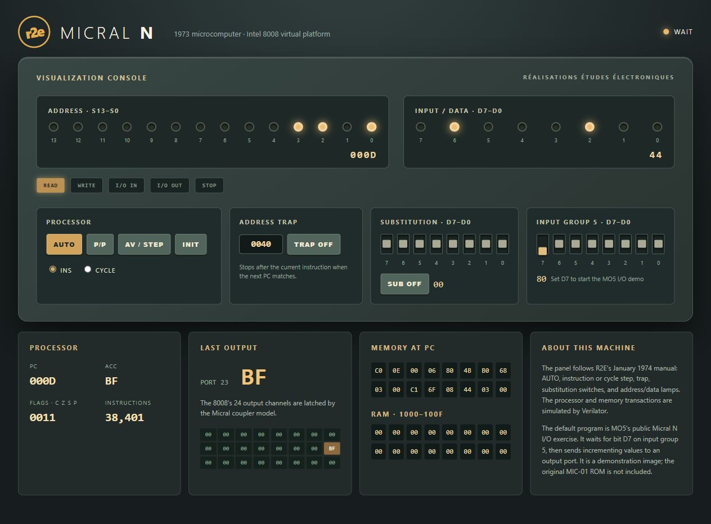

# Micral N virtual system

R2E introduced the Intel 8008-based Micral N in **1973**. Its modular Pluribus design supported configurable memory and I/O cards; the optional front console was intended for development and service. This reconstruction wires the repository's 8008 CPU into a 16 KiB system memory, I/O input groups and output latches, and a browser front panel — and it runs the machine's original firmware: the [boot EPROM and MIC-01 monitor ROM](spec/reference/micral_rom_recovery.md) recovered during the MO5/hxc2001 restoration, hash-verified against the published checksums.

## Original ROM: booting the MIC-01 monitor

`scripts/prepare_rom_image.py` composes the boot EPROM (256 bytes at page 0) and the monitor (2 KiB at 0x3800–0x3FFF) into `build/micral_rom.hex`. Start the panel with `MICRAL_IMAGE` pointing at it, or from the repository root in the project tool image:

```sh
docker run --rm -p 127.0.0.1:8082:8080 -v "$PWD:/work" -w /work \
  -e MICRAL_IMAGE=/work/system/micral_n/build/micral_rom.hex \
  ai-hw-engineer:latest sh system/micral_n/scripts/run_system.sh
```

The monitor is entered exactly as the January 1974 manual prescribes (section II.3.1): with the machine in AUTO, switch SUB on, set the data switches to `44`, press **AV / STEP** in CYCLE mode, repeat with `30` and `3B`, switch SUB off, and press **AUTO**. The substituted bytes are `JMP $3B30`, the monitor's initial entry. The monitor then announces itself on the [ASR-33 teletype](#asr-33-teletype) panel section: a CR LF SP prompt line, echoed command letters followed by `: `, `?` for unknown commands, and the `M` memory-display command. The boot EPROM itself is a floppy-disk loader; with the disk system unmodeled it halts, which is why the manual's panel procedure is the documented way in.

`tb/tb_monitor.sv` verifies this end to end at the RTL level (ROM checksums are implicit: any ROM byte change breaks the expected teletype sequence), and `scripts/test_backend.py` repeats it over HTTP.

## Web interface and waveform



The live RTL console paused after running the MO5 I/O exercise with input
group 5 bit D7 enabled. The processor state, address/data lamps, teletype and
latched output are visible. This panel does not yet implement waveform
capture or an embedded waveform viewer, so this screenshot shows the console only.

## ASR-33 teletype

The panel's teletype section models the 11100/SC async card on input group 0 (manual II.2.4–II.2.5): typed characters enter the receiver FIFO the monitor reads with `INP 0`, and monitor output is printed with the parity bit stripped for display. Bit-level 110-baud timing is not modeled; the monitor's software parity survives on the wire (its CR prints as `0x8D`). The Pile card — the hardware LIFO the monitor uses for subroutine state — is modeled as well.

## Execution model

The browser poll is the clock source while the panel is open: each `/api/state` poll runs at most 1200 simulated cycles, so AUTO speed follows the poll rate and execution pauses when the tab is hidden. This differs from the Busicom bridge's background-thread model and is deliberate for a front-panel tool; headless use (the backend test) drives the simulator over the private pipe instead.

## Run

From the repository root, using the project's tool image:

```sh
docker run --rm -p 127.0.0.1:8082:8080 -v "$PWD:/work" -w /work \
  ai-hw-engineer:latest sh system/micral_n/scripts/run_system.sh
```

Open <http://localhost:8082/>. The default image is the MO5 I/O exercise: toggle input bit **D7** on the panel, then press **AUTO**; the output port value changes as the simulated CPU executes. **P/P** pauses, **AV / STEP** advances an instruction or cycle, **TRAP** stops at a chosen PC, **SUB** supplies the data-switch byte in place of memory reads, and **INIT** resets the CPU. These controls follow section VI of the R2E manual. The panel shows live address, data, cycle, PC, accumulator, flags, output latches, teletype, and a memory window. The server binds to loopback by default; set `MICRAL_HOST` to expose it deliberately.

Run the automated tests with `sh system/micral_n/scripts/run_all.sh` in the same image: lint, the two MO5 regressions, the front-panel RTL semantics test, the monitor ROM regression, and the HTTP backend test.

## References

- [R2E Micral N User Manual, January 1974 (searchable Markdown extraction)](spec/reference/MICRAL_N_Users_Manual_Jan74.md), [original PDF scan](../../references/MICRAL_N_Users_Manual_Jan74.pdf), and [source OCR text](../../references/MICRAL_N_Users_Manual_Jan74_ocr.txt). Sources: [PDF archive](https://www.mirrorservice.org/sites/www.bitsavers.org/pdf/r2e/MICRAL_N_Users_Manual_Jan74.pdf); [OCR archive](https://archive.org/download/bitsavers_r2eMICRALN_19057147/MICRAL_N_Users_Manual_Jan74_djvu.txt).
- [Intel 8008 manual and Markdown transcription](../../design/intel_mcs8/intel_8008/README.md).
- [Recovered original ROMs](spec/reference/micral_rom_recovery.md): provenance, checksums, memory map, and the verification performed here. Sources: the [hxc2001 restoration](https://hxc2001.pages-perso.free.fr/micral-n/index.html) and the [MO5 association's ROM analysis](https://mo5.com/site/lecture-et-sauvegarde-des-roms-du-micral-n/).
- [MO5's Micral N I/O exercise source](spec/reference/mo5_input_output.asm) and [binary](src/rom/mo5_input_output.bin) from [MO5's virtual Micral N project](https://github.com/Asso-MO5/virtual_micral_n/tree/main/data). The default image is a modern demonstration; the original monitor is included alongside it.

See the [system specification](spec/spec.md), [implementation plan](plans/implementation_plan.md), and [test report](report/final_report.md) for the exact modeled behavior and limitations.
