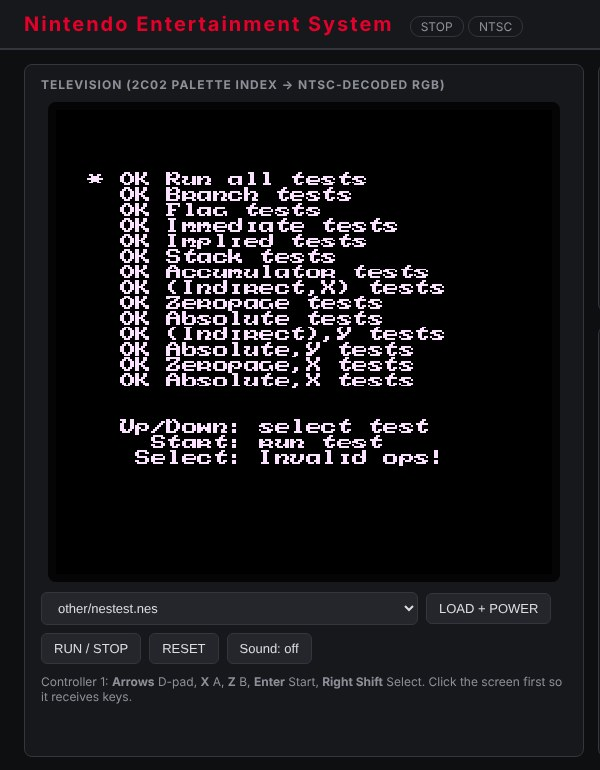

# Nintendo Entertainment System (Nintendo, 1983)

**First introduced: 1983.** Nintendo's Family Computer launched in Japan in
1983 and, restyled as the Nintendo Entertainment System, in North America in
1985 ([history](https://en.wikipedia.org/wiki/Nintendo_Entertainment_System#History)).
It revived the home console market after the 1983 crash and set the
cartridge-plus-licensing model that later consoles followed. Only
year-level claims are made here.

This virtual platform wires the repository's
[Ricoh 2A03/2A07 CPU+APU](../../design/ricoh_2a03/) (a native NMOS 6502 with
decimal mode disabled, plus the APU, DMA and controller ports) and
[Ricoh 2C02/2C07 PPU](../../design/ricoh_2c02/) into the console board:
one master clock (21.477 MHz NTSC, 26.602 MHz PAL), 2 KiB work RAM, 2 KiB
CIRAM with cartridge-controlled mirroring, the CPU open-bus latch, two
standard controllers, and NROM, MMC1, UxROM and CNROM cartridge boards. The
reset button and power-on are separate inputs, so APU state and cartridge
mapper state survive a reset as on the real console.

## Web interface and waveform



The RTL console after running kevtris's `nestest` ROM from its menu: every
official-opcode group reports **OK**. The television decodes the 2C02's
6-bit palette indices with an NTSC composite approximation in the browser.
The full panel also has a board-state table (PC, registers, raster
position, frame and CPU-cycle counts, controller byte) and a waveform panel
that captures up to 200,000 master clocks to FST and opens it in the
embedded Surfer viewer. Surfer is built only into the project's Docker
image, so it is not visible in this screenshot taken outside that image;
the FST capture endpoint itself is verified by `scripts/test_backend.py`.

Reproduce: start the panel, choose `other/nestest.nes`, press
**LOAD + POWER**, then **RUN / STOP**; click the screen and press **Enter**
(Start) to run all tests.

## Run

From the repository root, using the project's tool image:

```sh
docker run --rm --name nes -p 127.0.0.1:8820:8080 \
    -v "$PWD:/work" -w /work ai-hw-engineer:latest \
    sh system/nes/scripts/run_system.sh
```

Open <http://localhost:8820/> (Windows PowerShell: mount
`-v B:/ai_hw_engineer:/work`). The script fetches the hash-pinned public
test ROMs into ignored `work/roms/`, builds the Verilator model and serves
the panel. Set `-e NES_REGION=1` for the 2A07/2C07 PAL console. Any
mapper 0–3 iNES file you own can be copied into `system/nes/work/roms/` and
selected from the list; commercial games are never fetched.

Keyboard (click the screen first): **arrows** D-pad, **X** A, **Z** B,
**Enter** Start, **Shift** Select. **RESET** presses the console's
reset button; **LOAD + POWER** power-cycles with the chosen cartridge.

Run the complete verification with:

```sh
docker run --rm -v "$PWD:/work" -w /work ai-hw-engineer:latest \
    sh system/nes/scripts/run_all.sh
```

## Verification and boundaries

`scripts/run_all.sh` runs lint for both regions, the board testbench, the
real-software regression (the `nestest` CPU trace compared line by line,
including cycle counts, against Nintendulator's 8,991-line log, plus 75
blargg and community test ROMs for CPU timing, interrupts, DMA, PPU
vblank/NMI/sprite timing, open bus and APU timing in NTSC and PAL), the
backend API test and a Yosys synthesis check. Measured results and the two
known test-ROM differences are in the [final report](report/final_report.md).

Not modelled: composite video and the analog audio filters (approximated in
the browser), expansion-port and Famicom-only hardware, mappers beyond
0–3, and the MMC1 PRG-RAM disable bit. See the [specification](spec/spec.md)
for the assumption ledger.
