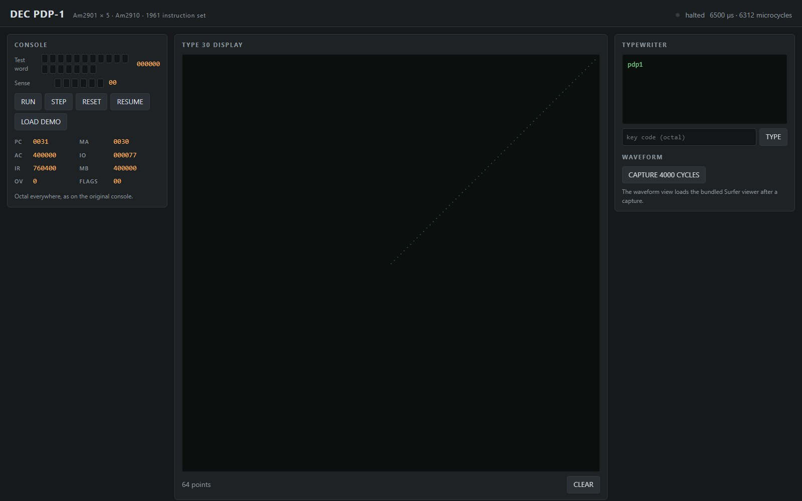

# DEC PDP-1 — Am29xx bit-slice reconstruction

**First introduced: 1959.** DEC's PDP-1 was the company's first computer and
the first commercial machine designed for interactive use; about fifty were
built. The Computer History Museum's PDP-1 restoration exhibition records the
1959 launch and the machine's role in early interactive computing, including
Spacewar! ([CHM PDP-1 exhibition](https://www.computerhistory.org/pdp-1/introduction)).
The exhibition states the year, not a month, so no month is asserted here.

This system reconstructs the PDP-1's 1961 instruction set on **five AMD
Am2901 four-bit slices and one Am2910 microsequencer**, with the 18-bit
architectural word carried inside a 20-bit slice chain. It is a working
machine, not a behavioural CPU standing in for the parts: the microcode drives
the real slice ALU and register file, the Am2910 sequences the control store,
and 4096 words of core memory, the console, the paper-tape reader and punch,
the typewriter and a Type 30 point-plot display are wired around them.

The original PDP-1 was built from DEC 5000-series discrete modules; the Am2900
family arrived in 1975, sixteen years later. This reconstruction answers the
owner-requested question "could the PDP-1 be built from Am29xx parts, and would
it then run its own software?" It makes no claim of transistor-level,
electrical or package-level fidelity to either machine — see
[the specification](spec/spec.md) for the sourced profile, the assumption
ledger and the stated limits.

## Status

| Area | State |
| --- | --- |
| 1961 instruction set (27 legal opcodes incl. `mus`/`dis`) | implemented in microcode and verified |
| External oracle comparison | 100/100 instructions of seven directed programs match the SIMH PDP-1 exactly (PC/AC/IO/OV); two arithmetic defects remain (see below) |
| Verilator lint | clean (`-Wall` with documented local waivers) |
| Synthesis | 6,298 cells, 360 latch bits, all inside the five Am2901 slices |
| Console, typewriter, paper tape, Type 30 display | functional models, exercised by the panel demo |
| Sequence break | implemented (one channel); not yet exercised by authentic software |
| Spacewar! 4.1 | image archived with provenance; **not yet run** (needs the paper-tape read-in path and the display break timing) |

What runs today: the machine boots from the front panel, executes the full
1961 instruction set, plots points on the Type 30 model, types concise-coded
characters, and halts. The directed regression in `tests/` and the microcode
regression in `scripts/` cover every opcode.

## Web interface and waveform



The panel after running `tests/demo.pdp1`: the Type 30 display shows the
64-point sweep the program drew through the real display IOT path, the console
table shows the live PC/AC/IO/IR/MB/MA/flags of the RTL machine, and the
typewriter pane shows the concise-coded message. The waveform panel captures
4,000 microcycles to `work/waveform.fst` and embeds the bundled Surfer viewer;
the screenshot above shows the front panel, not the waveform viewer. See
[the report](report/final_report.md) for the capture commands and the current
limits of the Surfer embedding.

Reproduce:

```sh
docker run --rm -p 127.0.0.1:8090:8090 -v "$PWD:/work" -w /work \
    ai-hw-engineer:latest sh system/pdp1_am29xx/scripts/run_panel.sh
```

Open <http://localhost:8090/>, press **LOAD DEMO** then **RUN**. **CAPTURE
4000 CYCLES** writes the FST and opens Surfer at `/surfer/?load=/waveform.fst`.

## Run

The machine is a SystemVerilog model built with Verilator. From the repository
root, in the project tool image:

```sh
sh system/pdp1_am29xx/scripts/build_sim.sh          # builds work/obj/Vpdp1_am29xx
sh system/pdp1_am29xx/scripts/run_panel.sh          # web front panel on :8090
```

Batch use, for the oracle diff or a single program:

```sh
system/pdp1_am29xx/work/obj/Vpdp1_am29xx --batch \
    --image work/demo.hex --trace work/demo.trace --max-micro 4000
```

## Verification and boundaries

```sh
sh system/pdp1_am29xx/scripts/run_lint.sh      # verilator --lint-only -Wall
sh system/pdp1_am29xx/scripts/run_synth.sh     # yosys elaboration and cell count
sh system/pdp1_am29xx/scripts/run_all.sh       # lint, oracle-diff inputs, synthesis
```

The oracle is SIMH's PDP-1 simulator (`PDP1/pdp1_cpu.c`, commit pinned in
`spec/reference/simh_commit.txt`), an independent implementation that runs the
same memory image and prints its instruction history. The comparison covers
PC, AC, IO and OV at every instruction start and stops at the first difference.
Current result: **100 of 100 instructions match** across seven directed
programs (arithmetic with positive/negative zero and end-around carry, logic,
all twelve shift/rotate subcodes, jumps and subroutine linkage, the skip group,
index/compare, and the operate group).

Two arithmetic defects remain, both found by the oracle and both with exact
reproducers in [the report](report/final_report.md):

1. **Spurious overflow flag.** `0o370000 + 0o4000` sets OV although the
   operands and result share a sign. Software that tests `szo` (Spacewar!
   included) cannot be trusted yet.
2. **End-around-carry repair loop on subtraction.** `0o1235 - 0o000001`
   enters the repair loop and leaves AC = 0 instead of `0o1234`; the loop runs
   hundreds of iterations before the machine continues. The `arith` program
   passes because its subtraction cases happen to avoid the condition.

Neither defect is worked around in the tests: `tests/smoke.pdp1` and
`tests/demo.pdp1` exist to reproduce them.

Not covered, and stated as limits rather than implied: no transistor-level or
electrical timing, no destructive core read, no PDP-1D extensions, no
16-channel sequence break, no DECtape/printer/clock, and no display-list
revision. `mus`/`dis` follow the 1961 handbook's multiply/divide *step*
definition; SIMH implements a later AC×M/AC÷M option for the same opcodes, so
those two instructions are excluded from the oracle diff and checked against
the handbook rule instead. Spacewar! is not yet run.

- [Specification](spec/spec.md)
- [Implementation plan](plans/implementation_plan.md)
- [Test plan](plans/testplan.md)
- [Verification report](report/final_report.md)
