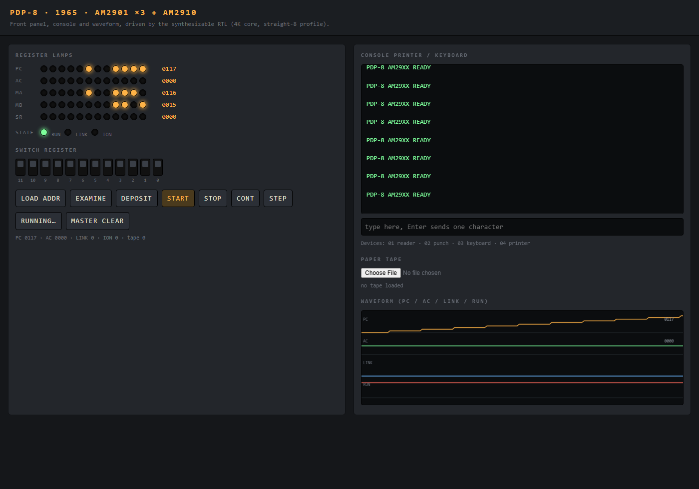

# PDP-8 (1965) on an Am29xx bit-slice datapath

A functional reconstruction of the original 1965 PDP-8 built from **three AMD
Am2901 4-bit slices**, an **Am2910 microprogram sequencer** and a microcoded
control store: 12-bit words, 4K of core, the eight opcode groups, auto-index,
the front panel, an ASR-33 style console and paper-tape reader/punch. Status:
CPU, memory, panel and console are implemented and verified against an
independent instruction-set model; historical application software (FOCAL-69,
*Lunar Lander*) and DEC diagnostics are **not yet run**.

The original PDP-8 did not use Am29xx parts — those are 1970s components. This
is a retro-computer implemented with deliberately later chips; the architecture
is the 1965 machine, the implementation technology is bit-slice. Reused chip
models come from the canonical [Am29xx family](../../design/amd_am29xx/README.md)
(`amd_am2901`, `amd_am2910`).

## History

Digital Equipment Corporation introduced the PDP-8 in **1965** at **$18,500**.
It was a 12-bit, single-accumulator machine with 4K words of core memory, sold
as a "Programmable Data Processor" because the company's backers did not want
DEC to be seen selling "computers". The PDP-8 family became the best-selling
computer in the world by 1973 and is often described as the Model T of the
industry: the first computer mass-produced at a price almost anyone could
afford. Sources: D. W. Jones, [PDP-8 FAQ](https://homepage.divms.uiowa.edu/~jones/pdp8/faqs/)
(model table: PDP-8, 1965, $18,500, 12 bits, ~50,000 sold; "the first computer
to be mass produced at a cost that just about anyone could afford"), and the DEC
PDP-8 handbook material summarised in the [specification](spec/spec.md).

The Am2901 slice first appeared in **1975** (contemporary August 1975
*Microcomputer Digest* coverage cited in
[the chip profile](../../design/amd_am29xx/amd_am2901/README.md)); the Am2910
is documented as existing **by 1978**, with its exact introduction year not
established ([chip profile](../../design/amd_am29xx/amd_am2910/README.md)).

## Web interface and waveform



The panel is driven by the synthesizable RTL, not by a software model. The
capture shows a looping printer program (`PDP-8 AM29XX READY`) running with the
panel in free-run: the PC, MA and MB lamp rows track the instruction stream,
the console panel shows the printer output, and the waveform draws the last 160
cycles of PC, AC, LINK and RUN from the simulator's trace ring. AC is flat
because the loop clears it for every character; PC shows the staircase of
successive instruction addresses.

Reproduce:

```sh
sh scripts/build.sh
PDP8_PORT=8099 python3 host/server.py           # inside the container
# browser: http://localhost:8099/?run=1
```

`?run=1` starts free-run on load. Without it, use the RUN (free), STEP and key
buttons. The page was captured with headless Chrome at 1400x980 after the loop
had printed several banners.

## Run

```sh
# from the repository root, with the ai-hw-engineer image
docker run --rm -p 8099:8099 -v "$PWD:/repo" -w /repo/system/pdp8_am29xx \
    ai-hw-engineer:latest sh -c 'sh scripts/build.sh && PDP8_PORT=8099 python3 host/server.py'
```

Then open `http://localhost:8099/`. The front panel offers:

- twelve switch-register toggles (address, deposit data and OSR operand),
- LOAD ADDR, EXAMINE, DEPOSIT, START, STOP, CONT, STEP,
- a console field that types into the keyboard device and shows printed output,
- a paper-tape file picker that loads the reader image.

Initial actions for a hand-entered program: toggle the address, LOAD ADDR,
toggle the data, DEPOSIT, repeat, then LOAD ADDR to the first word and START.

## Verification and boundaries

```sh
docker run --rm -v "$PWD:/repo" -w /repo ai-hw-engineer:latest \
    sh system/pdp8_am29xx/scripts/run_all.sh
```

Runs the microassembler, lint, both testbenches, the host simulator build, 47
instruction-set agreement tests (exhaustive operate encodings, directed
addressing/control, 40 random programs) against the independent model in
`scripts/pdp8_ref.py`, the panel/interrupt sequence, and Yosys synthesis.
Latest results: **47 passed, 0 failed; panel and interrupt PASS; synthesis
5,365 cells (4,829 LUT4, 216 latches, 319 flip-flops)**.

Known boundaries, recorded in full in the [report](report/final_report.md):

- **No historical software booted yet.** FOCAL-69, the *Lunar Lander* listing
  and DEC MAINDEC diagnostics are future work; the reader and console are
  exercised by short directed programs only.
- **No EAE**, so group 3 is a no-op (correct for a machine without the option).
- **Not cycle accurate**: a memory-reference instruction is roughly 12-18
  microcycles; character timing is instantaneous.
- **Interrupt coverage is directed**, not exhaustive.
- Verification compares the RTL against a model written from DEC and SIMH
  documentation. Agreement with SIMH is not proof of agreement with the
  original hardware; the assumption ledger lists every such item.

- [Specification](spec/spec.md)
- [Implementation plan](plans/implementation_plan.md)
- [Test plan](plans/testplan.md)
- [Verification report](report/final_report.md)
- [Microprogram source](src/pdp8_microcode.asm)
