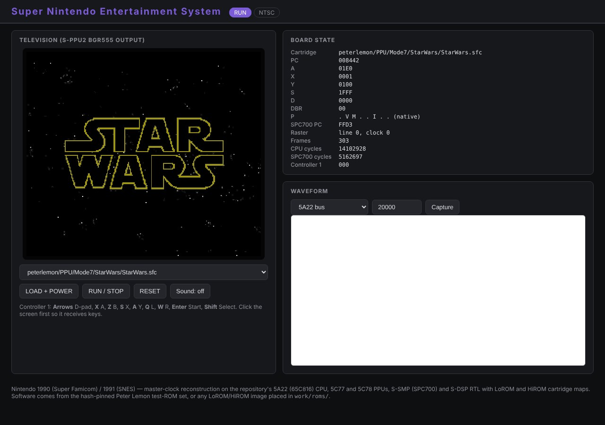

# Super Nintendo Entertainment System (Nintendo, 1990)

**First introduced: 1990.** Nintendo's Super Famicom launched in Japan on
21 November 1990 and, as the Super Nintendo Entertainment System, in North
America in 1991 ([history](https://en.wikipedia.org/wiki/Super_Nintendo_Entertainment_System#History)).
It was Nintendo's 16-bit successor to the NES and brought hardware Mode 7
rotation and scaling, colour math between two screens and an eight-voice
sample-based sound module designed by Sony to home consoles. Only
year-level claims are made here.

This virtual platform wires seven chips from this repository into the
console board:

- [Ricoh 5A22 S-CPU](../../design/ricoh_5a22/) around the
  [WDC 65C816](../../design/wdc_65c816/) core: memory timing, DRAM refresh,
  DMA/HDMA, multiplier and divider, H/V interrupts and auto-joypad read.
- [Ricoh 5C77 S-PPU1](../../design/ricoh_5c77/) and
  [Ricoh 5C78 S-PPU2](../../design/ricoh_5c78/): backgrounds, sprites,
  Mode 7, windows, colour math, high resolution and interlace.
- [Sony S-SMP](../../design/sony_s_smp/) with the
  [SPC700](../../design/sony_spc700/) core, and the
  [Sony S-DSP](../../design/sony_s_dsp/), sharing 64 KiB of audio RAM.

One master clock (21.477 MHz NTSC, 21.281 MHz PAL) drives everything
through clock enables, including the 1.024 MHz APU clock. The board has
128 KiB of work RAM, 64 KiB of VRAM, LoROM and HiROM cartridge maps with
battery SRAM, and two standard controllers. Power-on and the reset button
are separate inputs, so the PPU state and memories survive a reset as on
the real console.

## Web interface and waveform



The RTL console running Peter Lemon's `StarWars` Mode 7 demo, whose
stars are sprites and whose title is a Mode 7 plane, after 303 frames.
The television shows S-PPU2's 15-bit RGB output at 512×480 so that
high-resolution and interlaced pictures keep every pixel. The board state
table shows the 65C816 and SPC700 registers, the raster position, frame,
CPU-cycle and SPC700-cycle counts and the controller bits. The waveform
panel captures up to 200,000 master clocks to FST and opens it in the
embedded Surfer viewer; Surfer is built only into the project's Docker
image, so the panel is empty in this screenshot taken outside that image.
The FST capture endpoint itself is verified by `scripts/test_backend.py`.

Reproduce: start the panel, choose `peterlemon/PPU/Mode7/StarWars/StarWars.sfc`,
press **LOAD + POWER**, then **RUN / STOP**.

## Run

From the repository root, using the project's tool image:

```sh
docker run --rm --name snes -p 127.0.0.1:8821:8080 \
    -v "$PWD:/work" -w /work ai-hw-engineer:latest \
    sh system/snes/scripts/run_system.sh
```

Open <http://localhost:8821/> (Windows PowerShell: mount
`-v B:/ai_hw_engineer:/work`). The script fetches the hash-pinned Peter
Lemon test ROMs and the IPL boot ROM into ignored `work/` folders, builds
the Verilator model and serves the panel. Set `-e SNES_REGION=1` for the
PAL console. Any LoROM or HiROM image you own (no coprocessor) can be
copied into `system/snes/work/roms/` and selected from the list;
commercial games are never fetched. The model runs at about 2.7 frames per
second, so demos and tests work but games are very slow.

Keyboard (click the screen first): **arrows** D-pad, **X** A, **Z** B,
**S** X, **A** Y, **Q** L, **W** R, **Enter** Start, **Shift** Select.
**RESET** presses the console's reset button; **LOAD + POWER**
power-cycles with the chosen cartridge. **Sound** plays the S-DSP's 32 kHz
output in the browser.

Run the complete verification with:

```sh
docker run --rm -v "$PWD:/work" -w /work ai-hw-engineer:latest \
    sh system/snes/scripts/run_all.sh
```

## Verification and boundaries

`scripts/run_all.sh` runs lint for both regions, the real-software
regression (88 Peter Lemon ROMs: CPU instruction and bank tests, SPC700
instruction tests, PPU demos compared frame by frame with the author's
screenshots, and sound demos), the backend API test and a Yosys synthesis
check of the whole board. Each CPU core also passes its SingleStepTests
record set cycle for cycle, and the S-DSP matches blargg's cycle-accurate
`SPC_DSP` register for register and sample for sample. Measured results and the known differences are
in the [final report](report/final_report.md).

Not modelled: coprocessor cartridges (Super FX, SA-1, DSP-n), the
expansion port, the multitap and light guns, the analog video and audio
paths, and dot-exact register changes in the middle of a visible line (the
PPUs render a line at a time). See the [specification](spec/spec.md) for
the assumption ledger.

- [Specification](spec/spec.md)
- [Implementation plan](plans/implementation_plan.md)
- [Verification report](report/final_report.md)
