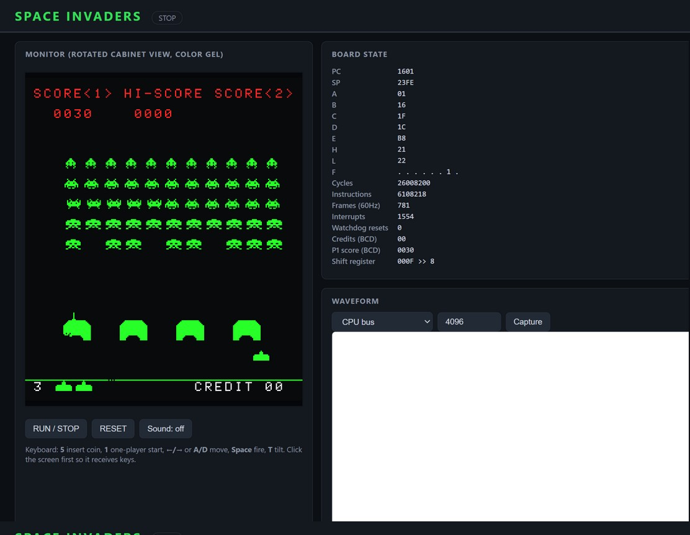

# Space Invaders (Taito, 1978)

**First introduced: 1978.** Taito's Space Invaders — designed by Tomohiro
Nishikado, licensed to Midway for the US market — ran on an Intel 8080 and
became the archetypal arcade hit, launching the golden age of video games.
Only the year-level claim is made here.

This virtual platform wires the repository's verified Intel 8080 RTL into
the original arcade board: 8 KiB game ROM, 1 KiB work RAM, the 7 KiB
frame-buffer VRAM, the hardware shift register the 8080 lacks shift opcodes
for, the coin/start/control input ports, the discrete-sound port latches,
the watchdog, and the two 60 Hz RST interrupts (RST 8 mid-screen, RST 10 at
vblank). The original Taito ROM set — fetched at run time from the immutable
PCjs archive, hash-verified against the canonical MAME checksums — boots
unmodified: attract mode plays, coins register, a one-player game starts,
and sweeping fire scores points, all in RTL.

## Web interface and waveform



The RTL cabinet frozen during a one-player game: the rotated monitor with
the original color-gel bands — `SCORE<1> HI-SCORE SCORE<2>` and the score
in the red strip, the alien rack with kills already on the board, the
green player/shield area with shields chewed by the scripted sweep-fire,
lives and spare ships on the base line —
plus the board-state table (frames, interrupts, BCD credits and P1 score)
and the waveform panel. The embedded Surfer viewer is known to crash in
the automation browser used for screenshots (the same image-bundled
Surfer 0.7.0 issue documented on the Altair panel), so no waves are
rendered in the image; the FST capture pipeline itself is verified by
`scripts/test_backend.py`.

Reproduce: start the panel, press **RUN / STOP** to boot into attract,
press **5** for a coin and **1** for one-player start, sweep with **→**
while pulsing **Space** until the score rises, then press **RUN / STOP**
to freeze and press **Capture** during play for a waveform.

## Run

From the repository root, using the project's tool image:

```sh
docker run --rm --name invaders -p 127.0.0.1:8810:8080 \
    -v "$PWD:/work" -w /work ai-hw-engineer:latest \
    sh system/space_invaders/scripts/run_system.sh
```

Open <http://localhost:8810/> (Windows PowerShell: mount
`-v B:/ai_hw_engineer:/work`). The machine powers up stopped; press
**RUN / STOP** to boot into attract mode. Keyboard: **5** coin, **1**
one-player start, **7** two-player start, **←/→** or **A/D** move,
**Space** or **F** fire, **T** tilt. Sound is a functional WebAudio
mapping of the discrete sound-latch bits, not the analog circuit.

Run the complete verification with:

```sh
docker run --rm -v "$PWD:/work" -w /work ai-hw-engineer:latest \
    sh system/space_invaders/scripts/run_all.sh
```

## Verification and boundaries

`scripts/run_all.sh` passes all five stages:

1. Strict lint of the board RTL.
2. Board testbench: boot of the original ROM, both interrupt vectors
   served at ~2 per 60 Hz frame, the shift-register example from the
   hardware documentation (writes 00→AA→FF, all eight offsets), and a coin
   inserting a BCD credit in work RAM — with the watchdog never firing.
3. Real-software regression (`scripts/test_software.py`): an exact
   independent-oracle checkpoint — CPU state, shift register and the full
   16 KiB decoded memory image agree byte-for-byte with a superzazu-8080
   board twin at an instruction boundary — then attract mode, coin,
   one-player start, and a sweep-fire run that scores (10+ points) on the
   real ROM; the oracle plays the same script and scores too.
4. Backend API test (request validation, screen payload, waveform
   endpoint).
5. Yosys synthesis check with the storage model blackboxed.

Functional reconstruction, per the 8080 design's bus contract: one clock is
one implementation step, not a native 8080 T-state. Interrupt cadence is
counted in those steps (33 280 per 60 Hz frame, events at 12 480/29 120),
so the CPU executes more instructions per frame than real hardware —
gameplay runs, but not with original per-instruction timing. Out of scope:
pin-level timing, video/CPU bus contention, discrete analog sound, the
cocktail-cabinet screen flip, coin payout hardware, and later board
revisions (Part II, the color boards with extra sound CPUs).

- [Specification and assumption ledger](spec/spec.md)
- [Implementation plan](plans/implementation_plan.md)
- [Reference provenance](spec/reference/README.md)
- [Verification report and limits](report/final_report.md)
